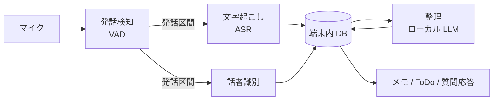

# ambient-memo

身の回りの会話や独り言を端末が聞き取り、文字起こし・話者識別・メモの整理・ToDo とリマインドの抽出・質問応答までを、**端末の中だけで**行う個人用の Android アプリ。

クラウドに頼らないエッジ完結の構成を試すことも、このプロジェクトの目的の1つ。

> 状態: 発話の検知、文字起こし、話者識別、保存、メモの整理、ToDo の抽出、一覧まで本物のモデルでつながり、エミュレーターで確かめた。Pixel の実機と実際の声は未確認で、質問応答はまだない。モデルは画面の操作でアプリが取得する(文字起こしは約 743 MB、話者は約 29 MB、整理は約 3.66 GB。文字起こしは Debug なら `mise run models:fetch`、`mise run models:push` でも入れられる)。決定事項は [docs/設計メモ.md](docs/設計メモ.md) を参照。

## やりたいこと

1. 常時マイクを監視し、発話を検知したら文字起こしを始める
2. 話者を識別する(まず「自分か、それ以外か」。会話の流れで名前が分かれば更新する)
3. 文字起こしを、話題や時間のまとまりごとにメモへまとめる
4. メモから ToDo とリマインドを抽出し、通知する
5. 「先週の打ち合わせで何を決めた?」のように、過去のメモへ質問できる

## 処理の流れ



電池を守るため、処理の重さで段階を分ける。

| 段階 | 処理 | 動くとき |
|---|---|---|
| 常時 | VAD | マイクの監視中ずっと |
| 発話時 | ASR、話者識別 | 発話を検知したときだけ |
| まとめて | LLM による整理 | 充電中など、余裕があるとき |

## 技術方針

| 領域 | 方針 | 状態 |
|---|---|---|
| 対象 | Android(Pixel 11)を先に作る。iOS は将来の選択肢 | 決定 |
| アプリ | React Native(Expo) | 決定 |
| エンジン | 音声処理とビジネスロジックを Kotlin に置く。RN は画面だけを担当 | 決定 |
| テスト | 結合テストを中心にしたテスティングトロフィーと、品質評価、実機指標 | 決定 |
| CI / 配布 | GitHub Actions。タグで署名済み APK を Actions の artifact に置く | 決定 |
| モノレポ | pnpm workspace | 決定 |
| ツール管理 | mise | 決定 |
| デザイン | デザイントークンと UI 部品を別パッケージに分ける | 決定 |
| データ | 端末外に送らない。音声は文字起こし後に捨てる | 決定 |
| VAD / ASR / 話者識別 | sherpa-onnx が第一候補 | 要検証 |
| LLM | LiteRT-LM と Gemma が第一候補 | 要検証 |
| DB | SQLite。ベクトル検索の方法は未定 | 要検証 |

### 検証すること

- 日本語をストリーミングで文字起こしできるモデルの有無と精度
- React Native から sherpa-onnx の話者識別を使う方法(Kotlin から直接呼ぶ想定)
- ローカル LLM の日本語での要約・抽出の品質
- 1日動かしたときの電池消費と発熱

## ディレクトリ構成

```text
apps/mobile/              画面(React Native)
packages/
  design-tokens/          デザイントークン
  ui-native/              UI 部品
  engine-client/          エンジンの TS 型、hooks、Fake 実装
engine/                   Kotlin(Gradle のマルチモジュール)
  domain/                 ビジネスロジック。Android に依存しない
  adapters*/              sherpa-onnx、LLM、DB、マイクの実装
  android/                Service、WorkManager、通知、receiver
modules/engine-bridge/    Expo Module。RN と Kotlin をつなぐ
tools/spike-asr/          ASR、VAD、話者識別の検証(公開データ)
tools/spike-llm/          ローカル LLM の検証(架空の評価セット)
docs/                     設計メモ、テスト戦略
```

依存の向きは `android` / `adapters` → `domain` だけ。詳しくは [docs/設計メモ.md](docs/設計メモ.md)、テストは [docs/テスト戦略.md](docs/テスト戦略.md) を参照。

## セットアップ

```bash
mise install
mise run setup
```

Android SDK は Android Studio が入れたものを使う。`~/Library/Android/sdk` にない場合は `ANDROID_HOME` を設定する。

| コマンド | 内容 |
|---|---|
| `mise run lint` | oxlint、oxfmt の確認、型検査、detekt、禁止する依存関係の確認 |
| `mise run fmt` | JS / TS の整形 |
| `mise run test` | Vitest と JUnit |
| `mise run mobile` | Metro を起動する |
| `mise run mobile:android` | 開発版をビルドして、エミュレーターか実機に入れる |
| `mise run mobile:prebuild` | `apps/mobile/android` を生成し直す |
| `mise run build:android:debug` | Debug の APK をビルドする(arm64) |
| `mise run build:android:release` | 署名済みの Release APK をビルドする(arm64)。下の環境変数が要る |

`apps/mobile/android` は生成物なのでコミットしない。ネイティブの設定は `apps/mobile/app.config.ts` と config plugin に書く。

`engine/gradle/libs.versions.toml` の AGP と Kotlin は、React Native の版に揃える。

## 配布

| きっかけ | アプリ ID | 版 | 置き場所 |
|---|---|---|---|
| `v1.2.3` のタグを push | `dev.ambientmemo.app` | `1.2.3` | Actions の artifact |
| Release のワークフローを `workflow_dispatch` で実行 | `dev.ambientmemo.app.dev` | `0.0.0-dev.<実行番号>` | Actions の artifact |
| 手元のビルド | `dev.ambientmemo.app.dev` | `0.1.0` | なし |

`versionCode` は Release のワークフローの実行番号を使う。ワークフローのファイル名を変えると番号が振り直されるので変えない。

APK は Release のワークフローの実行ごとに、zip せず `ambient-memo-<版>-arm64.apk` として置く。保持は 90 日で、過ぎると消える。

取得には GitHub へのログインが要る。スマホでは次の手順で受け取る。

1. ブラウザで GitHub にログインする
2. リポジトリの Actions から Release のワークフローを開き、成功した実行を選ぶ
3. ページの Artifacts にある APK を押してダウンロードし、開いてインストールする(初回は、ブラウザに提供元不明のアプリの許可が要る)

### 署名鍵

鍵が変わると上書きインストールできず、アンインストールすると端末内のメモも消える。鍵は一度だけ作り、GitHub Secrets とは別の場所(パスワードマネージャーなど)にも保管する。リポジトリにはコミットしない。

GitHub Actions には次の Secrets を設定する。足りないと Release のワークフローは、足りない名前を表示して失敗する。

| Secret | 内容 |
|---|---|
| `ANDROID_KEYSTORE_BASE64` | キーストアのファイルを base64 にしたもの |
| `ANDROID_KEYSTORE_PASSWORD` | キーストアのパスワード |
| `ANDROID_KEY_ALIAS` | 鍵の別名 |
| `ANDROID_KEY_PASSWORD` | 鍵のパスワード |

鍵の作り方と設定の例(パスワードは `keytool` の入力に従う。PKCS12 では鍵とキーストアのパスワードは同じになる):

```bash
mise exec -- keytool -genkeypair -v \
  -keystore ambient-memo-release.keystore \
  -alias ambient-memo -keyalg RSA -keysize 4096 -validity 36500

base64 -i ambient-memo-release.keystore | gh secret set ANDROID_KEYSTORE_BASE64
gh secret set ANDROID_KEYSTORE_PASSWORD
gh secret set ANDROID_KEY_ALIAS --body ambient-memo
gh secret set ANDROID_KEY_PASSWORD
```

手元で Release をビルドするときは、次の環境変数を渡す。無ければ Release のビルドは失敗する(debug の鍵には切り替えない)。

- `ANDROID_KEYSTORE_PATH`(キーストアのファイルの絶対パス)
- `ANDROID_KEYSTORE_PASSWORD`
- `ANDROID_KEY_ALIAS`
- `ANDROID_KEY_PASSWORD`

普段使いの版を手元でビルドするときは `APP_VARIANT=production` も渡す。

## プライバシー

常時マイクは、周りにいる人の声も拾う。そのため次の方針で作る。

- 聞き取り中は常に通知を表示し、手動ですぐに止められるようにする
- 音声は保存せず、文字起こし後に捨てる
- 文字起こし、メモ、話者の特徴量を端末の外へ送らない
- 通信はモデルの取得だけに使い、利用者の操作でだけ始める。モデルが確定したら、アプリの INTERNET 権限を外す
- 自分用の端末で使い、ストアでは公開しない

## このアプリを動かす人へ

常時マイクは、自分以外の声も文字にする。動かす前に次の点を考える。以下は法的な助言ではない。録音の扱いは国や地域、場面によって違うので、必要なら専門家に確かめる。

- **周囲の人に知らせる。** 同席する人や同居する人には、聞き取っていることを伝える。止めてほしいと言われたら止める。
- **自分が参加していない会話に注意する。** 隣の席や家族の会話も拾う。音声を捨てても文字起こしは残り、第三者の発言の記録になる。参加していない会話の録音は、自分が当事者の会話の録音よりリスクが大きいと考える。当事者の録音でも、常に問題がないとは言えない。
- **職場や学校の規程を確かめる。** 自分の端末でも、録音を禁じる規程に触れることがある。
- **国や地域の法律を確かめる。** 会話の全当事者の同意を求める国や地域がある(米国の一部の州など)。旅行や出張の間は止めるほうが安全。
- **話者の特徴量は機微な情報。** 声の特徴は、生体情報や個人情報として扱われることがある。端末の外には送らないが、周囲の人の特徴量を、本人が知らないまま端末に保存することになり得る。
- **誤りがある。** 話者を取り違えることがあり(合成会話の検証では、他人を「自分」と誤る率が約 30%)、文字起こしにも誤りがある。メモや ToDo を、そのまま事実や発言の証拠として扱わない。

## ライセンス

All rights reserved. このリポジトリを公開しているのはソースコードを読めるようにするためで、使用、複製、改変、再配布などの再利用は許諾しない。

第三者のモデル、データ、依存関係は、それぞれのライセンスに従う。これらはこのリポジトリに含めず、取得して使う(Gradle Wrapper の jar を除く)。
