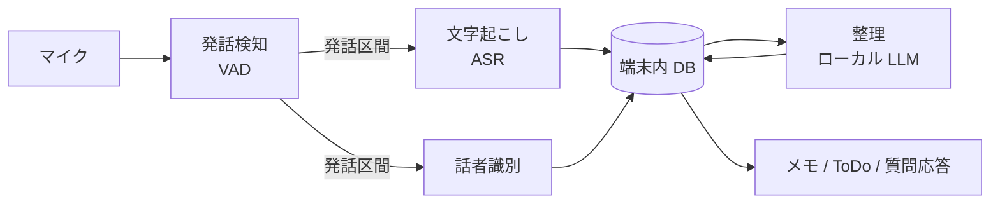

# ambient-memo

身の回りの会話や独り言を端末が聞き取り、文字起こし・話者識別・メモの整理・ToDo とリマインドの抽出・質問応答までを、**端末の中だけで**行う個人用の Android アプリ。

クラウドに頼らないエッジ完結の構成を試すことも、このプロジェクトの目的の1つ。

> 状態: 構想段階。コードはまだない。決定事項は [docs/設計メモ.md](docs/設計メモ.md) を参照。

## やりたいこと

1. 常時マイクを監視し、発話を検知したら文字起こしを始める
2. 話者を識別する(まず「自分か、それ以外か」。会話の流れで名前が分かれば更新する)
3. 文字起こしを、話題や時間のまとまりごとにメモへまとめる
4. メモから ToDo とリマインドを抽出し、通知する
5. 「先週の打ち合わせで何を決めた?」のように、過去のメモへ質問できる

## 処理の流れ



電池を守るため、処理の重さで段階を分ける。

| 段階 | 処理 | 動くとき |
|---|---|---|
| 常時 | VAD | マイクの監視中ずっと |
| 発話時 | ASR、話者識別 | 発話を検知したときだけ |
| まとめて | LLM による整理 | 充電中など、余裕があるとき |

## 技術方針

| 領域 | 方針 | 状態 |
|---|---|---|
| 対象 | Android(Pixel 11)を先に作る。iOS は将来の選択肢 | 決定 |
| アプリ | React Native(Expo) | 決定 |
| エンジン | 音声処理とビジネスロジックを Kotlin に置く。RN は画面だけを担当 | 決定 |
| テスト | 結合テストを中心にしたテスティングトロフィーと、品質評価、実機指標 | 決定 |
| CI / 配布 | GitHub Actions。タグで署名済み APK を GitHub Releases に置く | 決定 |
| モノレポ | pnpm workspace | 決定 |
| ツール管理 | mise | 決定 |
| デザイン | デザイントークンと UI 部品を別パッケージに分ける | 決定 |
| データ | 端末外に送らない。音声は文字起こし後に捨てる | 決定 |
| VAD / ASR / 話者識別 | sherpa-onnx が第一候補 | 要検証 |
| LLM | LiteRT-LM と Gemma が第一候補 | 要検証 |
| DB | SQLite。ベクトル検索の方法は未定 | 要検証 |

### 検証すること

- 日本語をストリーミングで文字起こしできるモデルの有無と精度
- React Native から sherpa-onnx の話者識別を使う方法(Kotlin から直接呼ぶ想定)
- ローカル LLM の日本語での要約・抽出の品質
- 1日動かしたときの電池消費と発熱

## ディレクトリ構成(予定)

```text
apps/mobile/              画面(React Native)
packages/
  design-tokens/          デザイントークン
  ui-native/              UI 部品
  engine-client/          エンジンの TS 型、hooks、Fake 実装
engine/                   Kotlin(Gradle のマルチモジュール)
  domain/                 ビジネスロジック。Android に依存しない
  adapters/               sherpa-onnx、LLM、DB、マイクの実装
  android/                Service、WorkManager、通知、receiver
modules/engine-bridge/    Expo Module。RN と Kotlin をつなぐ
tools/eval/               公開データでの精度評価
docs/                     設計メモ、テスト戦略
```

依存の向きは `android` / `adapters` → `domain` だけ。詳しくは [docs/設計メモ.md](docs/設計メモ.md)、テストは [docs/テスト戦略.md](docs/テスト戦略.md) を参照。

## セットアップ

```bash
mise install
```

Android SDK は Android Studio が入れたものを使う。

## プライバシー

常時マイクは、周りにいる人の声も拾う。そのため次の方針で作る。

- 聞き取り中は常に通知を表示し、手動ですぐに止められるようにする
- 音声は保存せず、文字起こし後に捨てる
- 文字起こし、メモ、話者の特徴量を端末の外へ送らない
- モデルが確定したら、アプリの INTERNET 権限を外す
- 自分用の端末で使い、ストアでは公開しない
