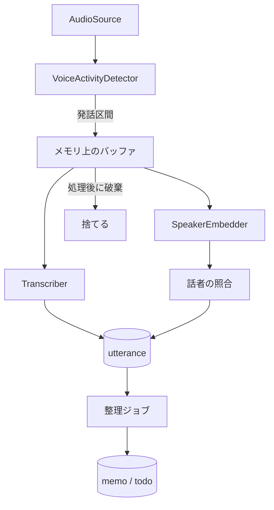

# エンジン設計

`engine/domain` の境界とデータモデルの案。実装しながら更新する。

## ポート

`domain` はこのインターフェース越しに外部を使う。

| ポート | 役割 | 本物の実装 | テスト用 |
|---|---|---|---|
| `AudioSource` | PCM のフレームを流す | `AudioRecord` | WAV ファイル |
| `VoiceActivityDetector` | フレームを発話か無音かに分ける | sherpa-onnx | 区間を指定する Fake |
| `Transcriber` | 発話区間を文字にする | sherpa-onnx | 固定の文字列を返す Fake |
| `SpeakerEmbedder` | 発話区間から特徴量を作る | sherpa-onnx | 固定のベクトルを返す Fake |
| `Llm` | プロンプトから文章を生成する | Gemma 4 E4B + LiteRT-LM(仮決定、未実装) | 固定の応答を返す Fake |
| `TextEmbedder` | 文章の検索用ベクトルを作る | 検証後に決定 | 固定のベクトルを返す Fake |
| `Repository` 群 | DB の読み書き | SQLite | メモリ上の Fake。結合テストは本物の SQLite |
| `Clock` | 現在時刻 | システム時刻 | 指定できる時計 |
| `Notifier` | リマインドの通知 | Android の通知 | 呼び出しを記録する Fake |

実装済みのポートは `AudioSource`、`VoiceActivityDetector`、`Transcriber`、`SpeakerEmbedder`、`Clock`、`UtteranceRepository`、`CaptureGapRepository`、`SpeakerRepository`、`Llm`(Fake のみ)、`MemoRepository`。定義は `engine/domain` の `Ports.kt` にある。

Fake、`WavAudioSource`、契約テストは `domain` の `testFixtures` に置き、`adapters` のテストからも使う。本物のアダプターを足すときは、`testFixtures` の契約テストの抽象クラスを継承して流す。音声の中身を見る実装は、契約テストの `speech()` を本物の発話に差し替える。

## sherpa-onnx のアダプター

JVM の jar と Android の AAR は API が違い、同じパッケージのクラスを持つ。同じクラスパスに置かないように、モジュールを分ける。

| モジュール | 役割 | 使う場所 |
|---|---|---|
| `adapters-sherpa` | jar にも AAR にも依存しない部分。`NativeVad`、`NativeRecognizer`、`NativeSpeakerExtractor` の境界、ポートの実装、`SherpaSettings`、`ModelCatalog`、`ModelStore`、`ModelDownloader` | 両方 |
| `adapters-sherpa-jvm` | jar の呼び出し | テストと Mac のツール |
| `adapters-sherpa-android` | AAR の呼び出し | アプリ |
| `adapters-sherpa-android-test` | AAR の実装に、端末で契約テストを流す。契約テストの名前の空白のために minSdk 30 が要るので分けた | 手元の端末 |

jar と AAR は Maven Central にないので、GitHub Releases を Ivy のリポジトリとして読む。指定は `engine/settings.gradle.kts` と `modules/engine-bridge/app.plugin.js` の2か所にある。

### 発話の区切りと前後の音声

値は `SherpaSettings` にある。`CaptureConfig` の既定値は使わない。

| 項目 | 値 | 理由 |
|---|---|---|
| VAD のしきい値 | 0.5 | 検証の第一候補 |
| 最短の発話 | VAD で 0.25 秒 | `minSpeechMillis` は 0。短い音は VAD が落とす |
| 区切りの無音 | VAD で 0.8 秒 | `minSilenceMillis` は 0.1 秒。下の注意を参照 |
| 発話の上限 | 20 秒 | `maxUtteranceMillis` と VAD の両方 |
| 語頭 | 0.6 秒 | 実音声 0.3 秒に、VAD の判定の遅れ 0.3 秒を足した |
| 語尾 | 足さない | 区切りの無音 0.8 秒の間も発話と判定するので、実音声が区間に入っている |
| 前後の無音 | 0.3 秒 | `SherpaTranscriber` が足す |

- 区切りを `minSilenceMillis` に任せて VAD の無音を短くすると、発話の途中で判定が切れ、続きの小さな音が最短の発話に届かず語が落ちた。JVS の 60 発話で、複数の区間に割れたものが 32 件になった。VAD に任せると 10 件で、VAD なしで全体を文字起こしした結果との差は 1.9%
- その代わり、保存する発話の開始は約 0.3 秒早く、終了は約 0.8 秒遅い
- VAD が切り出した区間はネイティブ側に溜まるので、フレームごとに捨てる。音声の切り出しは `UtteranceSegmenter` だけが行う
- モデルは聞き取りの開始では読み込まず、最初の発話で読み込む。開始を待たせず、発話がない間のメモリを増やさないため。読み込むと止めるまで持ち続ける

### モデルの配置

モデルは内部ストレージの `files/models/<パッケージの id>/` に置く。APK には入れず、利用者の操作でアプリが取得する(「モデルの取得」を参照)。

- 開発機からも入れられる。`mise run models:fetch` が配布物の SHA-256 を確かめて `engine/.cache/models` に取り出し、`mise run models:push` が `adb` で Debug ビルドへ入れる
- 聞き取りの開始時に `ModelStore.verify` がファイルごとの SHA-256 を確かめる。合わないファイルは消して開始を拒む。一度通ると `.verified` の印を残し、次からは大きさだけを見る
- モデルは `ModelCatalog.ACTIVE` で差し替える。`scripts/fetch-models.sh` も合わせて変える。`sensevoice-2024` への差し替えは JVM の契約テストで確かめている
- 話者のモデルは `ModelCatalog.ACTIVE_SPEAKER` で、配布物は 28 MB の `.onnx` 単体。文字起こしの必須のモデルではないので `SpeechModels` に入れず、なくても聞き取りは動く

### モデルの取得

利用者が外出先からスマホだけで APK を入れて試せるように、アプリがカタログのモデルを取得する。通信するのはこの処理だけで、モデルが確定したら取得のコードと INTERNET 権限を外す。

| 部品 | 役割 |
|---|---|
| `ModelSource` | カタログの配布物。`SingleFile`(Gemma のような単一ファイル)か `TarBz2`。URL、大きさ、SHA-256 を固定で持つ |
| `ModelDownloader` | 取得、配布物の確認、展開、`ModelStore` への配置、途中のファイルの掃除 |
| `ModelTransport` | 配布物を読む境界。本物は `HttpModelTransport` |
| `ModelDownloadRunner` | 取得を1本だけ動かし、状態を公開する |
| `ModelDownloadService` | dataSync 型の Foreground Service。アプリを離れても続ける |

流れはパッケージごとに次の通り。作業の場所は `files/model-downloads/<パッケージの id>/`。

1. `ModelStore.verify` が通るパッケージは通信しない
2. 残りの取得と展開の分と、64 MB の余裕を足した空き容量があるかを確かめる。なければ通信を始めない
3. 配布物を `artifact.part` へ読む。あれば `Range` で続きから読む
4. 配布物の SHA-256 を確かめる
5. `TarBz2` は、カタログにあるファイルだけを `staging/` へ取り出し、ファイルごとの SHA-256 も確かめる。配布物の中のパスは書き込み先に使わない
6. 名前の変更で `files/models/` へ移し、`.verified` の印を書いて、作業のディレクトリを消す

失敗したときの動き:

| 起きたこと | 動き | 途中のファイル |
|---|---|---|
| 通信が切れた、取得先が応じない | `NETWORK` | 残す。次は続きから |
| 利用者が止めた、プロセスが止まった | 止まる | 残す。次は続きから |
| 配布物やファイルのハッシュが合わない、本来より長い | `CORRUPTED` | 消す。次は最初から |
| 空き容量が足りない | `INSUFFICIENT_STORAGE`。取得前なら不足分も伝える | 残す |
| 取得先が `Range` を無視した | 最初から書き直す | 書き直す |
| 途中のファイルが配布物より長い、`416` が返った | 最初から読む | 消す |

- 再開で信じるのは最後の SHA-256 だけにする。途中の状態を別に記録しない
- 展開の途中のファイルは、成功でも失敗でも中断でも消す。`files/models/` には確かめたファイルしか入らない
- カタログから外れたモデルの途中のファイルは、次の取得で消す
- 転送は自分で追い、`https` の `github.com` と、その配布に使う `*.githubusercontent.com` の2つの場所だけを認める。送るのは `Range` だけ
- 自動では始めない。`startModelDownload` は画面のボタンからだけ呼ぶ。`START_NOT_STICKY` なので、OS が Service を再開して通信を始めることもない
- 自動の再試行はしない。通信が切れたら止まり、画面の「続きから取得する」で再開する
- 聞き取りを妨げない。`CaptureService` とは Service も通知も `CoroutineScope` も別にし、最低優先度の専用のスレッドで動かす。今はモデルが揃うまで聞き取りを始められないので、両方が同時に動くのは Gemma などを足してから
- 画面を消しても続くように、取得の間だけ部分 wake lock を持つ。上限は 6 時間
- API 35 以降の dataSync の Service は 1 日 6 時間で OS に止められる。`onTimeout` で止めて、途中までを残す
- bzip2 は Android にも JDK にもないので `commons-compress` を使う

### 雑音の文字

`NoiseTextFilter` が保存の前に短い文字を除く。1 文字は除き、2 文字は区間が 2 秒以上なら除く。仮の規則で、実際の会話では測っていない。除いた発話は欠落にしない。

## 処理の流れ

- 発話区間は上限の長さで区切り、長い発話でもメモリが増え続けないようにする
- 音声のバッファは、文字起こしと話者の処理が終わったら捨てる。例外のときも必ず捨てる
- 処理が追いつかないときは、古い音声から捨てて、欠落を記録する

## 最初のゴールのパイプライン

`CapturePipeline` が発話の検知から保存までを担当する。読み取りと文字起こしを別のコルーチンに分け、文字起こしが遅れても読み取りを止めない。

| 部品 | 役割 |
|---|---|
| `UtteranceSegmenter` | 語頭のリングバッファと、発話の上限ぶんの作業用バッファだけを持ち、発話区間を切り出す |
| `SegmentBacklog` | 文字起こし待ちの発話の置き場所。音声の長さの合計に上限を持つ |
| `SpeechSegment` | 発話の音声。`close` で 0 に塗りつぶす |

### 発話の区切り

既定値は仮。`CaptureConfig` で変えられる。アプリは sherpa-onnx に合わせた値を使う(「発話の区切りと前後の音声」を参照)。

| 項目 | 既定値 | 内容 |
|---|---|---|
| `maxUtteranceMillis` | 30 秒 | 超えると分割する。分割した区間の時刻は連続する |
| `minSilenceMillis` | 0.7 秒 | この長さの無音で発話の終わりとする |
| `preRollMillis` | 0.3 秒 | 検知より前の音声を残して、語頭の欠けを防ぐ |
| `minSpeechMillis` | 0.2 秒 | 短い音は雑音として捨てる。欠落にはしない |
| `maxBacklogMillis` | 120 秒 | 文字起こし待ちの音声の上限。16 kHz で約 3.8 MB |
| `discontinuityToleranceMillis` | 0.2 秒 | フレームの時刻のずれの許容量 |

### 失敗と欠落

音声を残さないので、失敗した発話はやり直せない。捨てた時間は `capture_gap` に残す。

| 起きたこと | 動き | `capture_gap` の理由 |
|---|---|---|
| 待ちが上限を超えた | 古い発話から捨てて続ける | `PROCESSING_BACKLOG` |
| 文字起こしか保存に失敗した | その発話を捨てて続ける | `PROCESSING_FAILED` |
| フレームの時刻が進む方向に飛んだ | 発話を区切り、VAD をリセットして続ける | `SOURCE_DISCONTINUITY` |
| フレームの時刻が戻った | 発話を区切り、VAD をリセットして続ける | 記録しない |
| 読み取りか VAD に失敗した | 溜まった発話を処理してから例外を投げる | 記録しない |
| キャンセルされた | 処理中、待ち、開いている発話を捨てる | `PIPELINE_STOPPED` |
| 欠落を保存できない | 例外で止まる。バッファは解放する | 記録できない |

- 欠落の書き込みは文字起こしのコルーチンで行う。文字起こしの最中に起きた欠落は、その発話が終わってから保存する
- キャンセルかどうかは例外の型ではなく、コルーチンの状態で判断する。アダプターの内側の `withTimeout` で処理全体が止まらないようにするため
- プロセスの強制終了では、メモリ上の音声も欠落の記録も失われる
- 読み取りの失敗から再開までの時間と、プロセスが止まっていた時間は、まだ記録しない

## 話者識別

`SpeakerIdentifier` が発話ごとに話者を判定し、`SelfEnrollment` が自分の声を登録する。モデルは CAM++ advanced(`docs/検証-ASR.md` は spike-asr ブランチ)。

- 判定は文字起こしの後、保存の前に `process` の `use` の内側で行う。保存しない発話の特徴量は作らない
- 特徴量の失敗や判定の失敗では、文字起こしを捨てない。話者を不明にして保存する。キャンセルは欠落になる
- 特徴量は区間全体から 1 つ作る。0.4 秒より短いとき、長さ 0 のとき、数でない値を含むときは不明にする。ごく短い音声では、Linux の x64 でネイティブが数でない値を返した
- 比べるのは同じモデルの版の特徴量だけ。モデルを変えると、登録し直すまで判定しない
- 自分の登録の前は判定しない。話者は不明のまま残る。「自分」のラベルがないと ToDo の抽出が自分の発話を見分けられず、特徴量の電池も無駄になる。そのため、未登録の間は仮の話者も作らない
- 登録の前の発話を、登録の後に遡って判定することはしない。音声がないのでできない

### 照合

値は `SpeakerConfig` にある。すべて仮で、端末で自分の声に合わせて調整する前提。調整の操作はまだない。

| 項目 | 既定値 | 内容 |
|---|---|---|
| `selfThreshold` | 0.6 | 検証の開始値。別の話者の集団で決めた値は持ち越しにくい |
| `provisionalThreshold` | 0.6 | 自分と同じ値から始める |
| `minReliableMillis` | 2.5 秒 | 区間は前後に約 1.4 秒の無音を含むので、実音声は約 1.1 秒。これより短い区間は既存の話者との照合だけに使う |
| `maxComparedSpeakers` | 64 | 周りの声で仮の話者が増えても、発話ごとの処理を増やし続けない。自分は必ず含む |

1. 最も類似度の高い話者がしきい値以上なら、その話者にする。類似度を `speaker_confidence` に残す
2. 誰にも近くなければ、十分な長さの区間なら仮の話者(「話者N」)を作る。比べる相手がないので信頼度は NULL。短い区間は不明にする
3. 仮の話者の特徴量は、十分な長さの区間の平均で更新する。自分の特徴量は登録のときのまま変えない。誤って受け入れた他人の声で崩さないため

### 自分の声の登録

- 画面の操作で、マイクから最大 45 秒聞く。3 秒以上の区間を 3 つ集めて、長さ 1 に正規化した特徴量の平均を記録する。値は `EnrollmentConfig` にある
- 区切りは照合と同じ設定で、発話の上限だけ 6 秒にする(`SherpaSettings.enrollmentCaptureConfig`)。続けて読み上げても区間が揃う
- 音声は `UtteranceSegmenter` の作業用バッファと `SpeechSegment` だけに持ち、例外やキャンセルでも解放する。ディスクには書かない
- 揃うまで記録しないので、途中で止めても前の登録は残る。登録し直しても過去の発話の話者は変えない
- 聞き取りとは同時に動かさない。`EnrollmentRunner` が 1 本だけ動かす
- 画面は初回の案内だけ。登録し直す操作はまだない

### 名前

| 由来 | 例 | 推定で変えるか |
|---|---|---|
| `self` | 自分 | 変えない |
| `provisional` | 話者1 | 変える |
| `inferred` | 推定した名前 | 変える |
| `manual` | 手で付けた名前 | 変えない |

推定の名前は `SpeakerRepository.setInferredName` だけが書き、この条件は SQL にある。自分の名前を手で変えても、整理ジョブのラベルは「自分」のままにする。プロンプトが「自分」を端末の持ち主と説明しているため。

### 特徴量の扱い

- `speaker_embedding` の外へ出さない。`engine-bridge` が JS へ渡すのは話者の種類と表示名だけ
- ログと例外のメッセージに入れない
- Android の自動バックアップは `allowBackup: false` で切ってある

### 区間に 2 人が入る問題

区切りは VAD の 0.8 秒のままなので、1 つの区間に 2 人が入る。検証の ASR は無音 0.5〜0.8 秒、話者は 0.2 秒がよかった。

JVS をつないだ合成会話 30 本で、VAD 0.8 秒の区間と、3 発話の平均の登録で測った(手元の一度きりの計測、スクリプトはコミットしていない)。時間で数えた値で、合成会話は発話の間が短いので参考値。2 人以上が 0.3 秒以上入る区間は、clean で 25%(175/704)、SNR 15 dB で 38%(183/485)だった。

| 条件 | しきい値 | 区間全体: 自分の再現率 | 他人を自分と誤る率 | 窓ずらし: 自分の再現率 | 他人を自分と誤る率 |
|---|---|---|---|---|---|
| clean | 0.5 | 98.0% | 47.9% | 78.5% | 12.2% |
| clean | 0.6 | 94.9% | 30.9% | 71.4% | 4.4% |
| clean | 0.7 | 84.1% | 13.3% | 52.3% | 2.1% |
| SNR 15 dB | 0.5 | 93.6% | 44.7% | 63.3% | 9.3% |
| SNR 15 dB | 0.6 | 85.6% | 28.2% | 40.1% | 2.5% |
| SNR 15 dB | 0.7 | 70.4% | 14.9% | 14.3% | 0.1% |

窓ずらしは、1.5 秒の窓を 0.75 秒ずつずらし、自分と判定した窓が過半数の区間を自分にした。他人の誤受入は大きく減るが、自分の再現率も大きく落ちる。文字起こしを窓の単位に分けられないので、区間全体の 1 つの判定のままにしている。

## Android 側の実装

`engine/android` がポートの本物をつなぎ、`modules/engine-bridge` が JS へ公開する。

| 部品 | 役割 |
|---|---|
| `Engine` | プロセスに1つ。依存の組み立て、開始と停止、発話の読み出し |
| `CaptureRunner` | `CapturePipeline` を1本だけ動かし、状態を公開する。最初のフレームが届いて初めて聞き取り中にする |
| `CaptureService` | マイク型の Foreground Service。`Engine` の状態を見て、止まったら自分で終わる |
| `PcmReaderAudioSource` | `AudioRecord` の読み取りをフレームにする。JVM のテストで契約テストを流す |
| `BootReceiver` | 再起動後に通知を出すだけ。マイクは開始しない |

- Debug も Release も本物のモデルで動く。開発用の Fake はない。モデルが端末になければ開始を拒み、画面で取得へ案内する
- Debug は内部ストレージに `debug-input.wav` があると、マイクの代わりに実時間で流す(`DevelopmentAudioSource`)。音声の入らないエミュレーターで確かめるため。Release にはこのコードが入らない
- フレームの時刻はサンプル数から数える。壁時計との差が `AudioRecord` のバッファ(1 秒)を超えたら音声が失われたとみなし、時刻を飛ばして `SOURCE_DISCONTINUITY` にする。それより短い欠落は検知できない
- 読み取りに失敗すると Service は止まり、画面と通知で知らせる。自動で再開はしない。バックグラウンドからマイクを開始できないため、`START_NOT_STICKY` にしている
- JS へ渡す発話の話者は `self`、`other`、`unknown` のどれかで、表示名を添える。`unknown` は未判定か判定できなかった発話

## データモデル

| テーブル | 主な項目 | 補足 |
|---|---|---|
| `utterance` | 開始・終了時刻、本文、信頼度、`speaker_id`、`speaker_confidence`、`organized_at_ms` | 文字起こしの最小単位。`organized_at_ms` が NULL なら未処理。`speaker_id` が NULL なら話者は不明 |
| `speaker` | 表示名、名前の由来(自分 / 仮 / 推定 / 手動)、`is_self` | 手動の名前を推定で上書きしない。自分は 1 人だけ |
| `speaker_embedding` | `speaker_id`、モデルの版、ベクトル(リトルエンディアンの 32 ビット浮動小数)、標本の数 | モデルの版ごとに持つ。モデルが変わると登録し直す |
| `memo` | 開始・終了時刻、タイトル、要約、`todo_extraction`、モデルの版 | 発話のまとまり。要約に失敗するとタイトルと要約は NULL |
| `memo_utterance` | `memo_id`、`utterance_id` | メモの根拠をたどる。1つの発話は1つのメモにだけ入る |
| `todo` | 内容、種類、期限(`due_date`)、状態、`memo_id` | 抽出元のメモをたどる。期限は時差を持たない `YYYY-MM-DD` |
| `reminder` | `todo_id`、通知時刻、状態 | 通知の予約と実績 |
| `capture_gap` | 開始・終了時刻、理由 | 記録できなかった時間 |
| `memo_embedding` | `memo_id`、ベクトル、モデルの版 | 質問応答の検索用 |

全文検索には SQLite の FTS を使う案を第一候補にする。

スキーマの版 3 にあるのは `utterance`、`capture_gap`、`memo`、`memo_utterance`、`todo`、`speaker`、`speaker_embedding`。`speaker_confidence` の範囲は DB で確かめない。SQLDelight が ADD COLUMN の列の CHECK を解析できないので、`domain` で確かめる。本文の列名は `body`。時刻は UNIX エポックからのミリ秒で持つ。`java.time` は minSdk 24 の端末で使えないので、`domain` に持ち込まない。

## SQLite のライブラリ

SQLDelight を使う。

| 候補 | 判断 |
|---|---|
| SQLDelight | 採用。同じ生成コードに Android と JVM のドライバーを差し替えられ、JVM の結合テストで本物の SQLite を動かせる。SQL をビルド時に検査し、マイグレーションの検証タスクもある。AGP 9 の Android ライブラリで動くことを確かめた |
| Room | 不採用。`domain` の Repository の裏に置くには注釈処理の準備が重い。JVM のテストの構成も SQLDelight より手間がかかる |
| 手書きの SQL | 不採用。Android の `SQLiteDatabase` と JDBC で別々のコードになり、テストと本番の実装が分かれる |

- JVM のテストは `sqlite-driver`(xerial の sqlite-jdbc)、端末は `android-driver` を使う
- 端末と JVM で SQLite の版が違う。SQLDelight の既定の方言(3.18)で検査し、新しい構文を使わない。Android 固有の動きは実機で確かめる
- `SqlDriver` を使う Repository の実装は `engine/adapters` に置く。`adapters` は Android ライブラリのままで、テストは JVM の単体テストとして動く

## スキーマの変更

1. `engine/adapters/src/main/sqldelight/migrations/<今の版>.sqm` に移行の SQL を書き、`.sq` も同じように変える
2. `engine/gradlew -p engine :adapters:generateDebugAmbientMemoDatabaseSchema` で新しい版の `databases/<新しい版>.db` を作り、コミットする
3. `engine/adapters/src/test/resources/migration-seeds/<新しい版>.sql` に、その版の全テーブルを埋める行を書く。過去の版の `.db` と種データは変更しない

`mise run test` は次のことを確かめる。

- `verifySqlDelightMigration`: 過去の版に `.sqm` を当てた結果が `.sq` と一致する
- `SchemaMigrationTest`: すべての版のスナップショットに種データを入れて現在の版へ移行し、構造が新規の DB と同じで、行と列の値が残っている

## 整理ジョブ

- 未処理の `utterance` を、無音の長さと話題の変化でまとまりに分ける
- 分割は、まず無音の長さの規則で行う。LLM は後から足す
- 再実行しても重複しないように、処理の区切りごとにトランザクションで記録する
- 充電が終わったら、区切りのよいところで止めて次回へ続ける

`OrganizeJob` が担当する。WorkManager からの起動はまだつないでいない。既定値は仮で、`OrganizeConfig` で変えられる。

| 項目 | 既定値 | 内容 |
|---|---|---|
| `minSilenceGapMillis` | 5 分 | 発話の間がこの長さ以上あくと分ける |
| `maxChunkChars` | 1,800 字 | 無音がなくても分ける上限。文脈長 4096 トークンに収めるため |
| `maxRetries` | 1 回 | 出力が読めなかったときの再試行 |

### まとまりの処理

1. 未処理の発話を読み、古い順にまとまりへ分ける
2. 最後のまとまりは、終わりから `minSilenceGapMillis` がたつまで処理しない。会話が続いていると、別のメモに分かれるため
3. まとまりごとに要約と ToDo 抽出の2回 LLM を呼ぶ
4. メモ、ToDo、`memo_utterance`、`organized_at_ms` を1つのトランザクションで記録する。根拠の発話がすでに処理済みなら何も書かない

- プロンプトは `tools/spike-llm/scripts/prompts.py` と同じ文面にして、テストで一字一句を比べる。thinking は使わない
- 「今日」は実行日ではなく、まとまりの開始時刻の端末の日付にする。夜の充電中に整理するので、実行日を使うと「明日」がずれる
- タイトルは要約の1行目から作る。LLM の呼び出しと、検証していないプロンプトを増やさないため
- 文字起こしは検証と同じ `[HH:mm] 自分: 本文` の形にする。話者が不明の発話は `[HH:mm] 本文` にする。検証にない形なので、評価はしていない。自分の登録の前の発話はすべてこの形になる
- 自分のラベルは名前を変えても「自分」。名前の改行とコロンは空白にする
- 期限の日付の手がかりは本文だけから探す。話者の名前(「明日香」など)を手がかりにしない

### 失敗

| 起きたこと | 動き |
|---|---|
| LLM が例外を投げた | そのまとまりを未処理のまま止める。結果は `LLM_FAILED` |
| 止めるように言われた | まとまりの間で止める。結果は `STOPPED` |
| キャンセルされた | 処理中のまとまりを捨てて、例外をそのまま伝える |
| DB への書き込みに失敗した | そのまとまりをロールバックして、例外をそのまま投げる |
| 要約が再試行しても空 | タイトルと要約を NULL にして記録する |
| ToDo の出力が再試行しても読めない | `todo_extraction` を `incomplete` にして記録する。読めた分があれば残す |
| 本文が空のまとまり | LLM を呼ばず、メモも作らずに処理済みにする |

- 出力が読めないまとまりを未処理で残すと、同じまとまりで毎回止まる。発話は残るので、記録して先へ進む
- LLM の例外が特定のまとまりでだけ起き続けると、そこで止まり続ける。実行基盤のつなぎ込みのときに、入力の長さなどの例外を見分ける
- キャンセルかどうかは、例外の型ではなくコルーチンの状態で判断する

### 期限の確度

LLM の出力に確度はないので、確かめられる条件で判定する。次のときは `todo.status` を `candidate` にする。確定した ToDo は `open`。

- 形式が違うか、存在しない日付。日付は捨てる
- 会話の日より前
- プロンプトで渡した 22 日分の日付の表の範囲外
- 文字起こしに日付の手がかりがない
- まとまりが日付をまたぐ

`due` が null の項目は、期限のない `open` にする。リマインドの予約は `open` だけを対象にする想定。

## リマインド

- 確定した時刻は `AlarmManager`、「充電中に整理」は `WorkManager` に任せる
- 端末の再起動で失われる予約は、起動時に DB から作り直す
- LLM が抽出した期限は誤ることがあるので、確度が低いものは ToDo の候補として表示する
