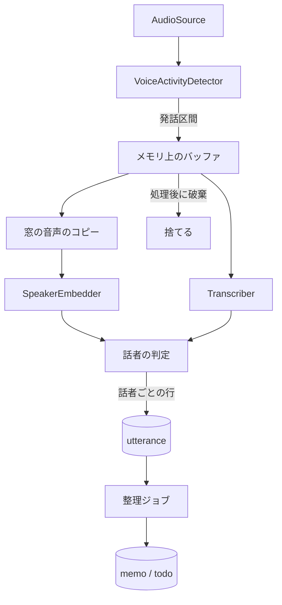

# エンジン設計

`engine/domain` の境界とデータモデルの案。実装しながら更新する。

## ポート

`domain` はこのインターフェース越しに外部を使う。

| ポート | 役割 | 本物の実装 | テスト用 |
|---|---|---|---|
| `AudioSource` | PCM のフレームを流す | `AudioRecord` | WAV ファイル |
| `VoiceActivityDetector` | フレームを発話か無音かに分ける | sherpa-onnx | 区間を指定する Fake |
| `Transcriber` | 発話区間を文字とトークンの時刻にする | sherpa-onnx | 固定の文字列を返す Fake |
| `SpeakerEmbedder` | 音声の範囲から特徴量を作る | sherpa-onnx | 固定のベクトルを返す Fake |
| `Llm` | プロンプトから文章を生成する | `LocalLlm` + LiteRT-LM + Gemma 4 E4B(仮決定) | 固定の応答を返す Fake |
| `TextEmbedder` | 文章の検索用ベクトルを作る | 検証後に決定 | 固定のベクトルを返す Fake |
| `Repository` 群 | DB の読み書き | SQLite | メモリ上の Fake。結合テストは本物の SQLite |
| `Clock` | 現在時刻 | システム時刻 | 指定できる時計 |
| `OrganizeAttempts` | まとまりごとの処理の回数を残す | ファイル | メモリ上の実装 |
| `Notifier` | リマインドの通知 | Android の通知 | 呼び出しを記録する Fake |

実装済みのポートは `AudioSource`、`VoiceActivityDetector`、`Transcriber`、`SpeakerEmbedder`、`Clock`、`UtteranceRepository`、`CaptureGapRepository`、`SpeakerRepository`、`Llm`、`MemoRepository`、`OrganizeAttempts`。定義は `engine/domain` の `Ports.kt` にある。`OrganizeAttempts` も実装した。

Fake、`WavAudioSource`、契約テストは `domain` の `testFixtures` に置き、`adapters` のテストからも使う。本物のアダプターを足すときは、`testFixtures` の契約テストの抽象クラスを継承して流す。音声の中身を見る実装は、契約テストの `speech()` を本物の発話に差し替える。

## sherpa-onnx のアダプター

JVM の jar と Android の AAR は API が違い、同じパッケージのクラスを持つ。同じクラスパスに置かないように、モジュールを分ける。

| モジュール | 役割 | 使う場所 |
|---|---|---|
| `adapters-sherpa` | jar にも AAR にも依存しない部分。`NativeVad`、`NativeRecognizer`、`NativeSpeakerExtractor` の境界、ポートの実装、`SherpaSettings`、`ModelCatalog`、`ModelStore`、`ModelDownloader` | 両方 |
| `adapters-sherpa-jvm` | jar の呼び出し | テストと Mac のツール |
| `adapters-sherpa-android` | AAR の呼び出し | アプリ |
| `adapters-sherpa-android-test` | AAR の実装に、端末で契約テストを流す。契約テストの名前の空白のために minSdk 30 が要るので分けた | 手元の端末 |

jar と AAR は Maven Central にないので、GitHub Releases を Ivy のリポジトリとして読む。指定は `engine/settings.gradle.kts` と `modules/engine-bridge/app.plugin.js` の2か所にある。

### 発話の区切りと前後の音声

値は `SherpaSettings` にある。`CaptureConfig` の既定値は使わない。

| 項目 | 値 | 理由 |
|---|---|---|
| VAD のしきい値 | 0.5 | 検証の第一候補 |
| 最短の発話 | VAD で 0.25 秒 | `minSpeechMillis` は 0。短い音は VAD が落とす |
| 区切りの無音 | VAD で 0.8 秒 | `minSilenceMillis` は 0.1 秒。下の注意を参照 |
| 発話の上限 | 20 秒 | `maxUtteranceMillis` と VAD の両方 |
| 語頭 | 0.6 秒 | 実音声 0.3 秒に、VAD の判定の遅れ 0.3 秒を足した |
| 語尾 | 足さない | 区切りの無音 0.8 秒の間も発話と判定するので、実音声が区間に入っている |
| 前後の無音 | 0.3 秒 | `SherpaTranscriber` が足す |

- 区切りを `minSilenceMillis` に任せて VAD の無音を短くすると、発話の途中で判定が切れ、続きの小さな音が最短の発話に届かず語が落ちた。JVS の 60 発話で、複数の区間に割れたものが 32 件になった。VAD に任せると 10 件で、VAD なしで全体を文字起こしした結果との差は 1.9%
- その代わり、保存する発話の開始は約 0.3 秒早く、終了は約 0.8 秒遅い
- VAD が切り出した区間はネイティブ側に溜まるので、フレームごとに捨てる。音声の切り出しは `UtteranceSegmenter` だけが行う
- 聞き取りでは、`QuietGatedVoiceActivityDetector` が -55 dBFS より静かなフレームを VAD に渡さず、無音と答える。VAD のモデルは無音にも毎回計算するので、静かな間の CPU を減らすため。VAD が発話と判定している間は、区切りの無音を数えさせるために静かなフレームも渡す。飛ばしたあとは VAD をリセットしてから渡す
- 飛ばしても、合成の雑音と本物の VAD と ASR の結合テストで文字は同じだった。区間の端は 0.1〜0.3 秒ずれた。20 dB 小さい声でも、飛ばさないときと同じ文字になった。-55 dBFS は仮の値で、実機の `audio_level` を見て見直す。自分の声の登録では飛ばさない
- モデルは聞き取りの開始では読み込まず、最初の発話で読み込む。開始を待たせず、発話がない間のメモリを増やさないため。読み込むと止めるまで持ち続ける

### モデルの配置

モデルは内部ストレージの `files/models/<パッケージの id>/` に置く。APK には入れず、利用者の操作でアプリが取得する(「モデルの取得」を参照)。

- 開発機からも入れられる。`mise run models:fetch` が配布物の SHA-256 を確かめて `engine/.cache/models` に取り出し、`mise run models:push` が `adb` で Debug ビルドへ入れる
- 聞き取りの開始時に `ModelStore.verify` がファイルごとの SHA-256 を確かめる。合わないファイルは消して開始を拒む。一度通ると `.verified` の印を残し、次からは大きさだけを見る
- モデルは `ModelCatalog.ACTIVE` で差し替える。`scripts/fetch-models.sh` も合わせて変える。`sensevoice-2024` への差し替えは JVM の契約テストで確かめている
- 話者のモデルは `ModelCatalog.ACTIVE_SPEAKER` で、配布物は 28 MB の `.onnx` 単体(`SingleFile`)。配布元のタグの綴りは `speaker-recongition-models`。文字起こしの必須のモデルではないので `SpeechModels` に入れず、なくても聞き取りは動く

### モデルの取得

利用者が外出先からスマホだけで APK を入れて試せるように、アプリがカタログのモデルを取得する。通信するのはこの処理だけで、モデルが確定したら取得のコードと INTERNET 権限を外す。

| 部品 | 役割 |
|---|---|
| `ModelSource` | カタログの配布物。`SingleFile`(Gemma のような単一ファイル)か `TarBz2`。URL、大きさ、SHA-256 を固定で持つ |
| `ModelDownloader` | 取得、配布物の確認、展開、`ModelStore` への配置、途中のファイルの掃除 |
| `ModelTransport` | 配布物を読む境界。本物は `HttpModelTransport` |
| `ModelDownloadRunner` | 取得を1本だけ動かし、状態を公開する |
| `ModelDownloadService` | dataSync 型の Foreground Service。アプリを離れても続ける |

取得の対象は `ModelCatalog.DOWNLOADS`。`ACTIVE` のパッケージと話者のモデルで、すべてに `ModelSource` が要る(`ModelStoreTest` が確かめる)。文字起こしのモデルだけが入った端末では、画面は聞き取りを止めずに話者のモデルの取得を案内する。取得が終わると、声の登録の状態を取り直す。

流れはパッケージごとに次の通り。作業の場所は `files/model-downloads/<パッケージの id>/`。

1. `ModelStore.verify` が通るパッケージは通信しない
2. 残りの取得と展開の分と、64 MB の余裕を足した空き容量があるかを確かめる。なければ通信を始めない
3. 配布物を `artifact.part` へ読む。あれば `Range` で続きから読む
4. 配布物の SHA-256 を確かめる
5. `TarBz2` は、カタログにあるファイルだけを `staging/` へ取り出し、ファイルごとの SHA-256 も確かめる。配布物の中のパスは書き込み先に使わない
6. 名前の変更で `files/models/` へ移し、`.verified` の印を書いて、作業のディレクトリを消す

失敗したときの動き:

| 起きたこと | 動き | 途中のファイル |
|---|---|---|
| 通信が切れた、取得先が応じない | `NETWORK` | 残す。次は続きから |
| 利用者が止めた、プロセスが止まった | 止まる | 残す。次は続きから |
| 配布物やファイルのハッシュが合わない、本来より長い | `CORRUPTED` | 消す。次は最初から |
| 空き容量が足りない | `INSUFFICIENT_STORAGE`。取得前なら不足分も伝える | 残す |
| 取得先が `Range` を無視した | 最初から書き直す | 書き直す |
| 途中のファイルが配布物より長い、`416` が返った | 最初から読む | 消す |

- 再開で信じるのは最後の SHA-256 だけにする。途中の状態を別に記録しない
- 展開の途中のファイルは、成功でも失敗でも中断でも消す。`files/models/` には確かめたファイルしか入らない
- カタログから外れたモデルの途中のファイルは、次の取得で消す
- 転送は自分で追い、`https` の `github.com` と、その配布に使う `*.githubusercontent.com`、Gemma の `huggingface.co` と `*.hf.co` だけを認める。送るのは `Range` だけ
- 自動では始めない。`startModelDownload` は画面のボタンからだけ呼ぶ。`START_NOT_STICKY` なので、OS が Service を再開して通信を始めることもない
- 自動の再試行はしない。通信が切れたら止まり、画面の「続きから取得する」で再開する
- 聞き取りを妨げない。`CaptureService` とは Service も通知も `CoroutineScope` も別にし、最低優先度の専用のスレッドで動かす。文字起こしのモデルがあれば話者のモデルの取得中も聞き取りを始められるので、両方が同時に動く。始めるときに話者のモデルが揃っていなければ、その聞き取りの間は話者を判定しない
- 画面を消しても続くように、取得の間だけ部分 wake lock を持つ。上限は 6 時間
- API 35 以降の dataSync の Service は 1 日 6 時間で OS に止められる。`onTimeout` で止めて、途中までを残す
- bzip2 は Android にも JDK にもないので `commons-compress` を使う

### 整理のモデルの取得

Gemma は `ModelCatalog.ACTIVE_LLM` に `SingleFile` で持つ。ファイルは `litert-community` の `gemma-4-E4B-it.litertlm`(3.66 GB)で、リビジョンと SHA-256 は検証と同じ。次善の `GEMMA_4_E2B` も持つ。

- 聞き取りのモデルとは組(`ModelGroup`)を分ける。利用者が画面で別に選び、なくても聞き取りはできる
- 取得は組をまたいで同時に1本だけ。作業の場所は組ごとに分ける。`ModelDownloader` は渡されなかったパッケージの途中のファイルを消すので、同じ場所では互いの途中のファイルを消してしまう
- 取得先は `huggingface.co` と `*.hf.co`。Hugging Face は `huggingface.co` から署名付きの URL で CDN(`us.aws.cdn.hf.co` など)へ転送する。ログインは使わない。CDN の名前が地域で変わるか分からないので、仮にドメインごと認める。転送先も `isModelHost` で確かめる
- 開発では `scripts/push-llm-model.sh` で端末へ入れられる

### 雑音の文字

`NoiseTextFilter` が保存の前に短い文字を除く。1 文字は除き、2 文字は区間が 2 秒以上なら除く。仮の規則で、実際の会話では測っていない。除いた発話は欠落にしない。

## LLM のアダプター

| モジュール | 役割 |
|---|---|
| `adapters-llm` | AAR に依存しない部分。`LocalLlm`、`LlmSettings`、失敗の見分け |
| `adapters-llm-android` | LiteRT-LM の AAR の呼び出し |
| `adapters-llm-android-test` | 本物のモデルで端末で動かす。契約テストと、架空の会話の整理 |

- モデルのメモリを持つのは `LocalLlm` だけ。`load` で読み込み、`close` で解放する。常駐させず、整理の間だけ持つ
- キャンセルされたら実行基盤に止めるよう頼み、止まるまで待つ。止まる前に解放しない
- 依頼ごとに `Conversation` を作り直す。履歴を持ち越すと文脈長を使い切る
- 設定は検証と同じ(文脈長 4096、top_k 1、温度 0)。制約デコードと thinking は使わない
- GPU を先に試し、だめなら CPU で動かす。OpenCL のない端末でも `initialize` は成功し、最初の生成で失敗するので、読み込みのときに 1 トークンだけ生成して確かめる
- LiteRT-LM は 0.16.1。0.17 以降は Kotlin 2.4 の `kotlin-reflect` を要求し、React Native の Kotlin 2.2 でコンパイルできない。検証は 0.19.0 だったので、**品質の評価は 0.16.1 では流していない**
- 文脈長の超過は型で見分けられないので、例外の文言で見分ける。版を上げたら確かめ直す
- 文脈長 4096 に入るのは、Mac の CPU で試した限り、繰り返しの多い文で約 5,700 字まで(`maxChunkChars` は 1,800 字)

## 処理の流れ



- 発話区間は上限の長さで区切り、長い発話でもメモリが増え続けないようにする
- 音声のバッファは、文字起こしと話者の処理が終わったら捨てる。例外のときも必ず捨てる
- 処理が追いつかないときは、古い音声から捨てて、欠落を記録する

## 最初のゴールのパイプライン

`CapturePipeline` が発話の検知から保存までを担当する。読み取りと文字起こしを別のコルーチンに分け、文字起こしが遅れても読み取りを止めない。

| 部品 | 役割 |
|---|---|
| `UtteranceSegmenter` | 語頭のリングバッファと、発話の上限ぶんの作業用バッファだけを持ち、発話区間を切り出す |
| `SegmentBacklog` | 文字起こし待ちの発話の置き場所。音声の長さの合計に上限を持つ |
| `SpeechSegment` | 発話の音声。`close` で 0 に塗りつぶす |

### 発話の区切り

既定値は仮。`CaptureConfig` で変えられる。アプリは sherpa-onnx に合わせた値を使う(「発話の区切りと前後の音声」を参照)。

| 項目 | 既定値 | 内容 |
|---|---|---|
| `maxUtteranceMillis` | 30 秒 | 超えると分割する。分割した区間の時刻は連続する |
| `minSilenceMillis` | 0.7 秒 | この長さの無音で発話の終わりとする |
| `preRollMillis` | 0.3 秒 | 検知より前の音声を残して、語頭の欠けを防ぐ |
| `minSpeechMillis` | 0.2 秒 | 短い音は雑音として捨てる。欠落にはしない |
| `maxBacklogMillis` | 120 秒 | 文字起こし待ちの音声の上限。16 kHz で約 3.8 MB |
| `discontinuityToleranceMillis` | 0.2 秒 | フレームの時刻のずれの許容量 |

### 失敗と欠落

音声を残さないので、失敗した発話はやり直せない。捨てた時間は `capture_gap` に残す。

| 起きたこと | 動き | `capture_gap` の理由 |
|---|---|---|
| 待ちが上限を超えた | 古い発話から捨てて続ける | `PROCESSING_BACKLOG` |
| 文字起こしか保存に失敗した | その発話を捨てて続ける。区間から分けた行は 1 つのトランザクションで保存するので、一部だけは残らない | `PROCESSING_FAILED` |
| フレームの時刻が進む方向に飛んだ | 発話を区切り、VAD をリセットして続ける | `SOURCE_DISCONTINUITY` |
| フレームの時刻が戻った | 発話を区切り、VAD をリセットして続ける | 記録しない |
| 読み取りか VAD に失敗した | 溜まった発話を処理してから例外を投げる | 記録しない |
| キャンセルされた | 処理中、待ち、開いている発話を捨てる | `PIPELINE_STOPPED` |
| 欠落を保存できない | 例外で止まる。バッファは解放する | 記録できない |

- 欠落の書き込みは文字起こしのコルーチンで行う。文字起こしの最中に起きた欠落は、その発話が終わってから保存する
- キャンセルかどうかは例外の型ではなく、コルーチンの状態で判断する。アダプターの内側の `withTimeout` で処理全体が止まらないようにするため
- プロセスの強制終了では、メモリ上の音声も欠落の記録も失われる
- 読み取りの失敗から再開までの時間と、プロセスが止まっていた時間は、まだ記録しない

## 話者識別

`SpeakerIdentifier` が発話区間の中で話者を判定し、話者の交代で本文を分ける。`SelfEnrollment` が自分の声を登録する。`SpeakerConsolidation` が増えすぎた仮の話者をまとめ直し、`SpeakerCorrections` が手の修正を受ける。モデルは CAM++ advanced(`docs/検証-ASR.md` は spike-asr ブランチ)。手順と値の根拠は `docs/検証-話者区間.md`。

- 判定は文字起こしの後、保存の前に `process` の `use` の内側で行う。保存しない発話の特徴量は作らない
- 特徴量の失敗や判定の失敗では、文字起こしを捨てない。区間全体を話者が不明の 1 行にして保存する。キャンセルは欠落になる
- 窓の音声は区間からのコピーなので、特徴量ごとに `use` で 0 に塗りつぶす。例外やキャンセルでも同じ。ディスクには書かない
- 窓が 0.4 秒より短いとき、長さ 0 のとき、数でない値を含むときは、その窓を飛ばして残りで判定する。すべて飛ばすと不明の 1 行にする。ごく短い音声では、Linux の x64 でネイティブが数でない値を返した
- 比べるのは同じモデルの版の特徴量だけ。モデルを変えると、登録し直すまで判定しない
- 自分の登録の前は判定しない。話者は不明のまま残る。「自分」のラベルがないと ToDo の抽出が自分の発話を見分けられず、特徴量の電池も無駄になる。そのため、未登録の間は窓も仮の話者も作らない
- 登録の前の発話を、登録の後に遡って判定することはしない。音声がないのでできない

### 判定の手順

値はすべて `SpeakerConfig` の 1 か所にある。すべて仮で、端末で自分の声に合わせて調整する前提。画面からの調整の操作はなく、「話者」の画面の判定の記録を見て値を変える。しきい値は 0.05 の違いで誤受入も再現率も大きく動く(`docs/検証-話者区間.md` の感度の表)。JVS のスタジオ音声で決めた 0.6 / 0.55 / 0.45 は、実機では自分を他人としやすかったので下げた。

| 項目 | 既定値 | 内容 |
|---|---|---|
| `windowMillis` | 1.5 秒 | 窓の長さ。発話の部分がこれ以下なら全体で 1 つの窓 |
| `hopMillis` | 0.75 秒 | 窓をずらす幅。最後の窓は発話の終わりに揃える |
| `trailingSilenceMillis` | 0.8 秒 | 区間の後ろの区切りの無音。窓に入れない。VAD の区切りの無音と揃える |
| `minWindowMillis` | 0.4 秒 | 無音を除くとこれより短いときは、無音を除かない |
| `selfThreshold` | 0.5 | 自分に入る類似度。不明の帯の上端も兼ねる |
| `selfExitThreshold` | 0.45 | これ未満で自分から出る |
| `unknownFloor` | 0.4 | 不明の帯の下端 |
| `strongSelfThreshold` | 0.6 | これ以上自分に近いまとまりは、他人と比べない |
| `rivalMargin` | 0.05 | 不明の帯を、知っている他人と比べて決めるのに要る差 |
| `selfOverrideMargin` | 0.1 | 弱い自分の判定を、知っている他人に変えるのに要る差 |
| `provisionalThreshold` | 0.45 | 既存の話者と判定する類似度。自分より緩くしてよい |
| `maxProvisionalSpeakers` | 3 | 仮の話者の上限。手で名付けた話者は数えない |
| `minNewSpeakerRunMillis` | 2 秒 | 新しい仮の話者を作るのに要るまとまりの長さ |
| `staleProvisionalMillis` | 7 日 | 上限に達していて、これだけ更新のない仮の話者は、新しい声に席を譲る |
| `consolidationThreshold` | 0.45 | まとめ直しで、上限以下でも統合する類似度 |
| `adaptMinScore` | 0.55 | 自分の声に足すのに要る、自分との類似度 |
| `adaptMinEnrolledScore` | 0.4 | 同じく、登録の特徴量との類似度 |
| `adaptRivalMargin` | 0.1 | 同じく、知っている他人との類似度の差 |
| `adaptMinRunMillis` | 2 秒 | 同じく、まとまりの長さ |
| `adaptMaxBoost` | 0.05 | 育てた声で類似度を上げられる幅 |
| `adaptBaseMillis` / `adaptMaxMillis` | 120 秒 / 600 秒 | 育てた声の重みの下限と上限。発話の長さで平均する |
| `minReliableMillis` | 2.5 秒 | 区間は前後に約 1.4 秒の無音を含むので、実音声は約 1.1 秒。これより短い区間は既存の話者との照合だけに使う |
| `minReliableRunMillis` | 1 秒 | 長い区間でも、これより短いまとまりは既存の話者との照合だけに使う。検証の無音を含まない部分の値 |
| `maxComparedSpeakers` | 64 | 周りの声で仮の話者が増えても、発話ごとの処理を増やし続けない。自分は必ず含む |

1. 窓ごとに自分との類似度を取る。区間の最初は「自分ではない」から始め、窓をまたいだ状態は区間を越えて持ち越さない
2. ヒステリシスで窓を自分かそれ以外に分け、同じ判定が続く窓を 1 つのまとまりにする。境界は隣り合う窓の中央の中点
3. まとまりの平均類似度が `unknownFloor` 以上 `selfThreshold` 未満なら不明にする。自分と判定された窓が続いていても不明にする。ただし、次の 4 の比較で決まることがある
4. トークンを開始時刻でまとまりへ割り振る。多数決にしない。句読点のような文字だけのトークンは前の語と同じまとまりに入れる
5. 文字のないまとまりは行にしない。時間は前の行に含める。無音や雑音で仮の話者が増えないように、話者を決める前に落とす
6. 類似度が `strongSelfThreshold` 未満のまとまりは、知っている他人で最も近い人と比べる。不明の帯なら差が `rivalMargin` 以上あるほうにする。弱い自分の判定でも、他人のほうが `selfOverrideMargin` 以上近ければ他人にする。しきい値を緩めた分の誤受入を、これで抑える
7. 自分のまとまりは自分にして、平均類似度を `speaker_confidence` に残す。確信の高い発話は育てた自分の声へ足す(下の「自分の声の更新」)
8. それ以外のまとまりは、窓の特徴量の平均を知っている他人と比べる。最も近い話者がしきい値以上ならその話者にして、類似度を残す。十分な長さなら、発話の長さで重み付けして重心を更新する
9. 誰にも近くなければ、`minNewSpeakerRunMillis` 以上のまとまりで、仮の話者が上限未満なら仮の話者(「話者N」)を作る。比べる相手がないので信頼度は NULL
10. 仮の話者が上限なら増やさない。長く更新のない仮の話者がいれば、その席を新しい声に譲る。いなければ最も近い仮の話者に入れて、類似度を残す。遠い声なので重心は動かさない
11. 上限未満でまとまりが短ければ不明にする
12. 隣り合う同じ話者の行を 1 行にする

分けられるのは自分かそれ以外かの交代だけ。他人どうしの交代は 1 行のままで、1 つの話者になる。検証の推薦も同じで、DER が案 C より高い理由でもある。

大人数で話すことがほとんどないので、他人は緩くまとめる。人の取り違えより「話者19」まで増えるほうを避ける。席を譲った話者の過去の発話は、同じ「話者N」の名前のまま残る。別の人の発話が同じ名前になるが、仮の名前なので許容する。

### 自分の声の更新

登録は端末を口元に持って静かな場所で読むので、聞き取りのときと条件が違い、類似度が下がる。登録の特徴量は変えず、別の `self_voice_adaptation` に育てた声を持つ。

- 足すのは、類似度、登録との類似度、他人との差、まとまりの長さのすべてが足りる発話だけ。発話の長さで平均し、重みには下限と上限がある
- 類似度は「登録との類似度」と「育てた声との類似度」の高いほう。ただし登録との類似度に `adaptMaxBoost` を足した値までしか上げない。育てた声は部屋や端末の癖も学ぶので、同じ場所にいる他人の類似度も上がるため
- 手で「自分」に直した発話は、この条件を見ずに足す
- 登録し直すと、すべての版の育てた声を消す

### まとめ直し

`SpeakerConsolidation` は、仮の話者が上限を超えているときだけ動く。以前の版で増えた話者を減らすためのもので、上限以下なら何もしないので、何度呼んでも結果は変わらない。

- `EngineBridgeModule` の起動時と、聞き取りを始めるときに呼ぶ。失敗しても聞き取りは止めない
- 最も近い 2 つの統合を、上限に収まるまで繰り返す。収まった後も `consolidationThreshold` 以上の組は統合する。発話の長さで重み付けして重心を作る
- 発話の話者の付け替え、統合元の特徴量と話者の削除、「話者N」の振り直しを 1 つのトランザクションで行う。統合元がもういなければその 1 件を飛ばす
- 対象は名前の由来が `provisional` の話者だけ。自分、手で名付けた話者、推定の名前の話者は統合しない。仮の話者に自分の声が入っていても自分へは統合しない。手で統合する

### 手で直す

`SpeakerCorrections` が受ける。判定から保存までと手の操作は `Engine` の同じ `Mutex` の内側で動かす。統合した話者の行が後から保存されないようにするため。

- 一覧の行を押すと、自分、他の話者、新しい他の話者、不明に直せる。新しい他の話者は仮の話者が上限なら出さない
- 「話者」の画面で、名前の変更、話者の統合、声の登録のやり直しをする。自分は統合元にできない。自分へ統合すると、統合元の重心を育てた声へ足す
- 直した発話の声がメモリにあれば、直した先の重心へ足す。`RecentVoices` が最近の 256 行の声をメモリにだけ持つ。発話ごとの特徴量を DB に残さないため、プロセスが終わると消え、古い発話は話者の付け替えだけになる。声は 1 度だけ使う
- 自分の行を他人に直しても、自分の判定を下げる仕組みはない。直した先の重心が近づくので、弱い自分の判定なら手順 6 で効く
- 作成済みのメモの要約と ToDo は作り直さない。根拠の発話の話者の表示だけが変わる

### 判定の記録

次の調整のために、判定の類似度の分布を `speaker_decision_stat` に日ごとに足す。判定、自分との類似度の 0.05 刻みの帯、回数、長さだけを持つので、発話や特徴量には戻せない。30 日より前の行は聞き取りを始めるときに消す。「話者」の画面で直近 7 日を見る。アプリが自動で端末の外へ送ることはない。利用者が動作の記録を書き出すと、直近 7 日の集計が最後の行に入る。

### 動作の記録

実機の速度、電池、発熱、夜の誤検知を、adb なしで測るための記録。文字起こしの画面の「記録」から始め、止め、書き出す。利用者が始めない限り何も残さない。

- 残すのは `DiagnosticEvent` の数値と列挙だけ。型に文字列の項目を持たせないので、本文や例外の文言は入らない。入出力は文字数だけを見る
- `DiagnosticsJournal` が `files/diagnostics/` に 1 行の JSON で書く。聞き取りと `:organize` が別のファイルに書き、開始と終わりの時刻を `session` のファイルで共有する。IPC は使わない
- 止めなくても 7 日で止まる。ファイルごとに 8 MB で新しい出来事を残さなくなる。始め直すと前の記録を消す。書けなくても聞き取りと整理は止めない
- 書き出しは利用者の操作でだけ動く。キャッシュに 1 つのファイルへまとめ、`FileProvider` と OS の共有の画面で渡す。送り先は利用者が選ぶ。共有の画面は今の Activity の上に開き、型は `application/x-ndjson` にする。`text/plain` だと本文の共有として扱われ、ファイルとして保存できない受け取り先がある
- ダウンロードへの保存も利用者の操作でだけ動く。MediaStore の Downloads に写すので権限は要らない。Android 10 より前は保存できない
- 1 行目は版と端末の種類、最後の行は話者の判定の集計。話者の名前と特徴量は含まない

| 出来事 | 内容 |
|---|---|
| `segment` | VAD の発火 1 回。区間の長さ、処理までの待ち、文字起こしと保存の時間、文字数、行数、結果(保存、空、雑音、失敗) |
| `gap` | 欠落の理由と長さ |
| `capture` | 聞き取りの開始と停止。OS に止められたかどうか |
| `device` | 5 分ごとと整理の前後。電池、充電量、温度、発熱の段階、画面、Doze、CPU 時間、メモリ、ピークのメモリ、起動からの時間 2 種 |
| `audio_level` | `device` と一緒に 5 分ごと。聞き取りのフレームの数、VAD を飛ばした数、フレームの大きさの 5 dB ごとの分布。大きさだけで、音声の中身は持たない |
| `llm_backend`、`llm_load` | GPU と CPU のどちらか。読み込みの時間と成否 |
| `llm_generate` | 入出力の文字数、出力の上限、時間、失敗。上限が 48 ならメモか ToDo のタイトル |
| `organize` | 実行の結果、メモと ToDo の数、時間 |

- `device` の間隔は端末が眠ると延びる。`elapsedMs` と `uptimeMs` の差の増え方で、眠っていた時間が分かる
- `:organize` の `device` が出たのに `llm_load` がなければ、読み込みが終わっていない
- 記録の取得は、アプリか聞き取りが動いている間だけ続く

### 行の分割

1 つの ASR の区間で話者が変わると、`utterance` を話者ごとに複数の行にする。1 行 1 話者を保ち、スキーマは変えない。

- 行の時刻は分割点に合わせる。先頭の行は区間の開始から、最後の行は区間の終了(区切りの無音を含む)までで、行の間に隙間はない
- 行は時刻の順に 1 つのトランザクションで保存する(`UtteranceRepository.insertAll`)。開始時刻が必ず増え、id も同じ順なので、`started_at_ms, id` の順に読む整理ジョブと一覧で順序が保たれる
- 文字起こしの信頼度と保存の時刻は同じ区間の行で共通
- `NoiseTextFilter` は分ける前の本文に 1 度だけ当てる。分けた行が短くても落とさない
- 分割点は窓の中央の中点なので、0.75 秒刻みでしか置けない

### トークンの時刻

`Transcriber` は本文と、区間の先頭からのトークンの時刻を返す(`TimedTranscription`)。`SherpaTranscriber` は `OfflineRecognizerResult` の `tokens` と `timestamps` から足した無音の 0.3 秒を引く。jar と AAR の両方で同じ API がある。

トークンがないとき、数が揃わないとき、つなげても本文にならないときは、本文を区間に均等に並べて、文字数で比例配分する(`timedTokens`)。本物のモデルではこの経路を通らないことを契約テストで確かめる。比例配分の精度は測っていない。

### 計算量

embedding は音声 1 分あたり約 7 回から約 67 回に増える。計算する音声は秒あたり 0.98 → 1.67 秒で、実時間比は Mac の 1 スレッドで 0.0051 → 0.0109(約 2.1 倍)。発話の後にだけ動き、発話のない間は動かない。20 秒の上限の区間でも 25 回程度で、Mac で約 0.25 秒。Pixel の速度、電池、発熱は測っていない。文字起こしと同じコルーチンで順に動くので、遅れると `SegmentBacklog` の待ちが増える。電池が足りないときの代わりはエネルギーの谷で分ける案(B1 d10)。

### 自分の声の登録

- 画面の操作で、マイクから最大 45 秒聞く。3 秒以上の区間を 3 つ集めて、長さ 1 に正規化した特徴量の平均を記録する。値は `EnrollmentConfig` にある
- 区切りは照合と同じ設定で、発話の上限だけ 6 秒にする(`SherpaSettings.enrollmentCaptureConfig`)。続けて読み上げても区間が揃う
- 音声は `UtteranceSegmenter` の作業用バッファと `SpeechSegment` だけに持ち、例外やキャンセルでも解放する。ディスクには書かない
- 揃うまで記録しないので、途中で止めても前の登録は残る。登録し直しても過去の発話の話者は変えない
- 聞き取りとは同時に動かさない。`EnrollmentRunner` が 1 本だけ動かす
- 音源は聞き取りと同じ `VOICE_RECOGNITION`。特徴量は区間全体から取り、聞き取りは 1.5 秒の窓から取るので、長さの条件は揃っていない。窓に揃えても測定の差は小さかった(`docs/検証-話者区間.md`)
- 画面は初回の案内と、「話者」の画面の登録のやり直し

### 名前

| 由来 | 例 | 推定で変えるか |
|---|---|---|
| `self` | 自分 | 変えない |
| `provisional` | 話者1 | 変える |
| `inferred` | 推定した名前 | 変える |
| `manual` | 手で付けた名前 | 変えない |

「話者N」の番号は使われていない最小の値にする。話者は統合で消えるので、番号が増え続けない。

推定の名前は `SpeakerRepository.setInferredName` だけが書き、この条件は SQL にある。自分の名前を手で変えても、整理ジョブのラベルは「自分」のままにする。プロンプトが「自分」を端末の持ち主と説明しているため。

### 特徴量の扱い

- `speaker_embedding` と `self_voice_adaptation` の外へ出さない。`engine-bridge` が JS へ渡すのは話者の id、種類、表示名、発話の数と、判定の集計だけ
- ログと例外のメッセージに入れない
- Android の自動バックアップは `allowBackup: false` で切ってある

## Android 側の実装

`engine/android` がポートの本物をつなぎ、`modules/engine-bridge` が JS へ公開する。

| 部品 | 役割 |
|---|---|
| `Engine` | プロセスに1つ。依存の組み立て、開始と停止、発話の読み出し |
| `CaptureRunner` | `CapturePipeline` を1本だけ動かし、状態を公開する。最初のフレームが届いて初めて聞き取り中にする |
| `CaptureService` | マイク型の Foreground Service。`Engine` の状態を見て、止まったら自分で終わる |
| `PcmReaderAudioSource` | `AudioRecord` の読み取りをフレームにする。JVM のテストで契約テストを流す |
| `BootReceiver` | 再起動後に通知を出すだけ。マイクは開始しない |
| `MemoBridge` | メモと ToDo を JS が読む形にする。Expo に依存しないので JVM のテストを通せる |
| `ObservableMemoRepository` | メモの記録と ToDo の完了を、書き込みが戻る前に `Engine.addMemoListener` の相手へ知らせる |
| `DebugMemoReceiver` | Debug だけ。整理ジョブの代わりに未処理の発話を1つのメモにする |

- Debug も Release も本物のモデルで動く。開発用の Fake はない。モデルが端末になければ開始を拒み、画面で取得へ案内する
- Debug は内部ストレージに `debug-input.wav` があると、マイクの代わりに実時間で流す(`DevelopmentAudioSource`)。音声の入らないエミュレーターで確かめるため。Release にはこのコードが入らない
- マイクは 1 秒ずつまとめて読み、0.1 秒のフレームに分けて流す。読む回数を減らし、このプロセスが CPU を起こす回数を減らすため。フレームの長さは変えないので、区切りの判定は変わらない。メモに残るまでが最大 1 秒遅れる。OS の音声の経路は自分の周期で動くので、これより長くしても減る分は小さいとみている
- フレームの時刻はサンプル数から数える。壁時計との差が `AudioRecord` のバッファ(3 秒)を超えたら音声が失われたとみなし、時刻を飛ばして `SOURCE_DISCONTINUITY` にする。それより短い欠落は検知できない
- 読み取りに失敗すると Service は止まり、画面と通知で知らせる。自動で再開はしない。バックグラウンドからマイクを開始できないため、`START_NOT_STICKY` にしている
- JS へ渡す発話の話者は `self`、`other`、`unknown` のどれかで、表示名を添える。`unknown` は未判定か判定できなかった発話

### メモと ToDo の接続

画面は `modules/engine-bridge` の `createMemoEngineClient` を使う。JS 側の変換は `memo-client.ts`、Kotlin 側は `MemoBridge`、Expo の関数は `EngineBridgeModule` にあり、形は3か所で合わせる。

- `getMemoMode` は常に `ready`。開発用の見本の帯は Fake だけのもの
- 整理ジョブが動くまで、実機の一覧は空のまま。整理ジョブは `Engine.memoRepository` を使う。別の Repository を組み立てると、`memos-changed` と `todos-changed` が出ない
- `memos-changed` はメモの記録で、`todos-changed` は ToDo のあるメモの記録と完了で出す。`SharedFlow` を通すと Promise の解決に遅れるので、リスナーを書き込みのスレッドで呼ぶ。発話の `utterances-changed` とは配送の方法が違う
- 完了済みの完了は何もしない。ない ToDo と数でない id は `todo-not-found` で reject する。ないメモは null
- 話者を手で直すと `utterances-changed` と `memos-changed` を出す。メモの詳細の根拠の発話を取り直すため

Debug でメモを投入するには次のようにする。未処理の発話を1つのメモにし、確定と候補の ToDo を1つずつ足す。発話がなければ見本の発話を足す。`DUMP` 権限を要るようにしてあり、ほかのアプリからは呼べない。Release には入らない。

```
adb shell am broadcast -n dev.ambientmemo.app.dev/dev.ambientmemo.engine.android.DebugMemoReceiver
```

### 契約テスト

`packages/engine-client/src/memo-contract.ts` が `MemoEngineClient` の契約。

| 対象 | 流す場所 | 通る範囲 |
|---|---|---|
| `FakeEngineClient` | `engine-client.test.ts` | Fake |
| `createMemoClient` | `modules/engine-bridge` の Vitest | JS の変換。ネイティブの代わりに Fake を同じ形に包む |
| `MemoBridge` | `MemoBridgeContractTest` | Kotlin と本物の SQLite。TS は JVM で動かないので同じ名前で書き直し、名前が揃っていることをテストで確かめる |

JS と Kotlin をまたいで同じテストが動くわけではない。Expo の値の変換、イベントの配送、イベントと Promise の順序は自動のテストが通らないので、エミュレーターで確かめる。

## データモデル

| テーブル | 主な項目 | 補足 |
|---|---|---|
| `utterance` | 開始・終了時刻、本文、信頼度、`speaker_id`、`speaker_confidence`、`organized_at_ms` | 文字起こしの最小単位。`organized_at_ms` が NULL なら未処理。`speaker_id` が NULL なら話者は不明。手で直すと `speaker_confidence` は NULL |
| `speaker` | 表示名、名前の由来(自分 / 仮 / 推定 / 手動)、`is_self` | 手動の名前を推定で上書きしない。自分は 1 人だけ |
| `speaker_embedding` | `speaker_id`、モデルの版、ベクトル(リトルエンディアンの 32 ビット浮動小数)、標本の数、発話の長さの合計 | モデルの版ごとに持つ。モデルが変わると登録し直す。版 4 までの行の長さは 1 標本を 2 秒として移行する |
| `self_voice_adaptation` | モデルの版、ベクトル、発話の長さの合計 | 聞き取りで育てた自分の声。登録し直すと消す |
| `speaker_decision_stat` | UTC の日、判定、類似度の帯、回数、長さ | 調整用の集計。発話や特徴量には戻せない |
| `memo` | 開始・終了時刻、タイトル、要約、`todo_extraction`、モデルの版 | 発話のまとまり。要約に失敗するとタイトルと要約は NULL |
| `memo_utterance` | `memo_id`、`utterance_id` | メモの根拠をたどる。1つの発話は1つのメモにだけ入る |
| `todo` | 内容、タイトル、種類、期限(`due_date`)、状態、`memo_id`、`completed_at_ms`、`completed_from_status` | 抽出元のメモをたどる。期限は時差を持たない `YYYY-MM-DD`。状態は `candidate`、`open`、`done` |
| `reminder` | `todo_id`、通知時刻、状態 | 通知の予約と実績 |
| `capture_gap` | 開始・終了時刻、理由 | 記録できなかった時間 |
| `memo_embedding` | `memo_id`、ベクトル、モデルの版 | 質問応答の検索用 |

全文検索には SQLite の FTS を使う案を第一候補にする。

完了の取り消しはまだないが、`done` にすると候補か確定かが分からなくなるので、前の状態を `completed_from_status` に残す。取り消しは、この値を `status` に戻して、2 つの列を NULL にすればよい。`domain` の `Todo` が持つのは `completedAtMillis` だけ。

スキーマの版 6 にあるのは `utterance`、`capture_gap`、`memo`、`memo_utterance`、`todo`、`speaker`、`speaker_embedding`、`self_voice_adaptation`、`speaker_decision_stat`。`speaker_confidence` の範囲は DB で確かめない。SQLDelight が ADD COLUMN の列の CHECK を解析できないので、`domain` で確かめる。本文の列名は `body`。時刻は UNIX エポックからのミリ秒で持つ。`java.time` は minSdk 24 の端末で使えないので、`domain` に持ち込まない。

## SQLite のライブラリ

SQLDelight を使う。

| 候補 | 判断 |
|---|---|
| SQLDelight | 採用。同じ生成コードに Android と JVM のドライバーを差し替えられ、JVM の結合テストで本物の SQLite を動かせる。SQL をビルド時に検査し、マイグレーションの検証タスクもある。AGP 9 の Android ライブラリで動くことを確かめた |
| Room | 不採用。`domain` の Repository の裏に置くには注釈処理の準備が重い。JVM のテストの構成も SQLDelight より手間がかかる |
| 手書きの SQL | 不採用。Android の `SQLiteDatabase` と JDBC で別々のコードになり、テストと本番の実装が分かれる |

- JVM のテストは `sqlite-driver`(xerial の sqlite-jdbc)、端末は `android-driver` を使う
- 端末と JVM で SQLite の版が違う。SQLDelight の既定の方言(3.18)で検査し、新しい構文を使わない。Android 固有の動きは実機で確かめる
- `SqlDriver` を使う Repository の実装は `engine/adapters` に置く。`adapters` は Android ライブラリのままで、テストは JVM の単体テストとして動く

## スキーマの変更

1. `engine/adapters/src/main/sqldelight/migrations/<今の版>.sqm` に移行の SQL を書き、`.sq` も同じように変える
2. `engine/gradlew -p engine :adapters:generateDebugAmbientMemoDatabaseSchema` で新しい版の `databases/<新しい版>.db` を作り、コミットする
3. `engine/adapters/src/test/resources/migration-seeds/<新しい版>.sql` に、その版の全テーブルを埋める行を書く。過去の版の `.db` と種データは変更しない

`mise run test` は次のことを確かめる。

- `verifySqlDelightMigration`: 過去の版に `.sqm` を当てた結果が `.sq` と一致する
- `SchemaMigrationTest`: すべての版のスナップショットに種データを入れて現在の版へ移行し、構造が新規の DB と同じで、行と列の値が残っている

## 整理ジョブ

- 未処理の `utterance` を、無音の長さと文字数の上限でまとまりに分け、まとまりを LLM で話題に分ける。メモは話題ごとに作る
- 再実行しても重複しないように、処理の区切りごとにトランザクションで記録する
- 充電が終わったら、区切りのよいところで止めて次回へ続ける。利用者が手動で始めた実行は充電切れでは止めない

`OrganizeJob` が担当する。実行は「実行のしかた」を参照。Debug の手動の確認には `DebugMemoReceiver` も使える。既定値は仮で、`OrganizeConfig` で変えられる。

| 項目 | 既定値 | 内容 |
|---|---|---|
| `minSilenceGapMillis` | 5 分 | 発話の間がこの長さ以上あくと分ける |
| `maxChunkChars` | 1,800 字 | 無音がなくても分ける上限。文脈長 4096 トークンに収めるため |
| `maxRetries` | 1 回 | 出力が読めなかったときの再試行 |
| `maxChunkAttempts` | 3 回 | 同じまとまりの処理がこの回数失敗したら飛ばす |

### まとまりの処理

1. 未処理の発話を読み、古い順にまとまりへ分ける
2. 最後のまとまりは、終わりから `minSilenceGapMillis` がたつまで処理しない。会話が続いていると、別のメモに分かれるため
3. 本文のある行が 2 つ以上あれば、行番号を付けて LLM に渡し、新しい話題が始まる行の番号を答えさせる。番号のほかの文字があるか、依頼が失敗したら、まとまり全体を1つの話題にする。本文が空の発話は前の行と同じ話題に入れる
4. 文字数の上限で切ったまとまりの最後の話題は記録せず、その発話から次のまとまりを作り直す。続きと一緒に1件のメモにするため。無音で区切ったまとまりと、話題が1つだけのまとまりは回さない
5. 話題ごとに要約、ToDo 抽出、メモのタイトルで LLM を呼び、ToDo が見つかれば1件ごとにタイトルでも呼ぶ
6. メモ、ToDo、`memo_utterance`、`organized_at_ms` を1つのトランザクションで記録する。根拠の発話がすでに処理済みなら何も書かない

- プロンプトは `tools/spike-llm/scripts/prompts.py` と同じ文面にして、テストで一字一句を比べる。thinking は使わない。話題の切れ目のプロンプトは検証にないもので、評価していない
- 1 つの話題だけで上限を超えると、今は上限で切れて別のメモになる。前のメモと同じ話題ならまとめる処理はまだない
- 「今日」は実行日ではなく、まとまりの開始時刻の端末の日付にする。夜の充電中に整理するので、実行日を使うと「明日」がずれる
- タイトルは要約から LLM で別に作る。要約の1行目は日付だけになることがあったため。使えない出力なら、日付だけでない要約の行で代わりにする。プロンプトは評価していない
- ToDo のタイトルは抽出した内容から LLM で1件ずつ作る。ToDo の抽出のプロンプトは評価の根拠なので変えない。使えない出力なら内容で代わりにする。プロンプトは評価していない。一覧はタイトルを出し、メモの詳細は内容を全部出す
- 文字起こしは検証と同じ `[HH:mm] 自分: 本文` の形にする。話者が不明の発話は `[HH:mm] 本文` にする。検証にない形なので、評価はしていない。自分の登録の前の発話はすべてこの形になる
- 自分のラベルは名前を変えても「自分」。名前の改行とコロンは空白にする
- 期限の日付の手がかりは本文だけから探す。話者の名前(「明日香」など)を手がかりにしない

### 失敗

| 起きたこと | 動き |
|---|---|
| LLM が例外を投げた | そのまとまりを未処理のまま止める。結果は `LLM_FAILED`。同じまとまりで `maxChunkAttempts` 回失敗したら飛ばす |
| 入力が文脈長を超えた(`LlmInputTooLongException`) | 発話を半分に分けて処理する。1 発話ならタイトルと要約を NULL にして記録する |
| 飛ばしたまとまりの後のまとまりを処理できた | 問題はそのまとまりにあったので、タイトルと要約を NULL にして記録する |
| 飛ばしたまとまりの後で処理できたものがない | 実行基盤の問題かもしれないので記録しない。結果は `LLM_FAILED` |
| 声を登録する | 発話が使えるたびに進み具合を知らせる。短い発話は読み直しを頼む。次の発話まで 45 秒聞いても使える声がなければ諦める |
| 話者をリセットする | 聞き取りと登録が止まっているときだけ行う。話者、声、育てた声、判定の記録を消し、発話の話者を外す。発話の本文、メモ、ToDo は残す |
| 止めるように言われた | まとまりの間で止める。結果は `STOPPED`。モデルの読み込み中なら、5 秒待って `:organize` のプロセスごと終える(読み込みはネイティブの中で止められない) |
| キャンセルされた | 処理中のまとまりを捨てて、例外をそのまま伝える |
| DB への書き込みに失敗した | そのまとまりをロールバックして、例外をそのまま投げる |
| 要約が再試行しても空 | タイトルと要約を NULL にして記録する |
| ToDo の出力が再試行しても読めない | `todo_extraction` を `incomplete` にして記録する。読めた分があれば残す |
| 本文が空のまとまり | LLM を呼ばず、メモも作らずに処理済みにする |

- 出力が読めないまとまりを未処理で残すと、同じまとまりで毎回止まる。発話は残るので、記録して先へ進む
- 回数は処理を始める前に増やす(`OrganizeAttempts`)。ネイティブのクラッシュは例外にならず、後の処理が動かないため。キャンセルでは戻す
- 回数はスキーマを変えずにファイルに残す。発話の id と回数だけで、中身は書かない。消えても数え直すだけ
- メモリ不足でプロセスが止められても 1 回に数える。後のまとまりが動かなければ記録しないので、発話は失われない
- キャンセルかどうかは、例外の型ではなくコルーチンの状態で判断する

### 実行のしかた

| 部品 | プロセス | 役割 |
|---|---|---|
| `OrganizeSchedule` | メイン | WorkManager の定期実行(6 時間ごと)を予約する。`Engine` の作成時に呼ぶ |
| `OrganizeWorker` | メイン | `OrganizeService` へ bind して、終わるのを待つ |
| `OrganizeMonitor` | メイン | 手動の実行の入口。`OrganizeService` の状態を受け取り、プロセスが落ちたことに気づく |
| `OrganizeService` | `:organize` | DB を開いて、モデルを読み込み、整理する。手動の実行では Foreground Service になる |
| `OrganizeRunner` | `:organize` | 実行を同時に1つにする。止める条件を確かめる。JVM でテストする |
| `OrganizeSession` | `:organize` | 読み込みから解放までの1回分。JVM でテストする |

- 定期実行の条件は、充電中、端末を使っていない(`requiresDeviceIdle`)、電池と空き容量が少なくない
- LLM を別のプロセスで動かす。マイクの Foreground Service はバックグラウンドから再開できないので、実行基盤のクラッシュやメモリ不足で巻き込むと、利用者が画面を開くまで聞き取りが止まる
- bind は `BIND_NOT_FOREGROUND` にして、聞き取りのプロセスの優先度を持ち込まない。スレッドも低い優先度で動かす
- 2 つのプロセスが同じ SQLite を使う。整理の書き込みはまとまりごとの短いトランザクションで、Android の既定の待ち時間(2.5 秒)に収まる想定
- `openAndroidDatabase` は、開いて移行するまでをファイルのロックで順番にする。SQLiteOpenHelper は版を読んでからトランザクションを始めるので、同時に開くと同じマイグレーションを 2 回当てるため
- 画面はメインのプロセスにあるので、`:organize` の `ObservableMemoRepository` の変更は `Messenger` で `OrganizeWorker` へ送り、`Engine` のリスナーへ渡す。`memos-changed` と `todos-changed` が聞き取りや画面の書き込みと同じように届く。`OrganizeMonitor` が受け取り、見守りがいないときだけ `OrganizeWorker` が受け取る。どちらもいないときは画面もないので、次に開いたときに読み直す
- 定期実行を止める条件は、充電が切れた、WorkManager に止められた、端末が熱い(`THERMAL_STATUS_SEVERE` 以上)。まとまりの間で確かめる
- WorkManager に止められたら、処理中のまとまりを最大 60 秒待つ。超えたら捨てる。未処理のまま残るので次の実行が続きから処理する
- 実行基盤が動かないときは同じ予約で 3 回まで試し、後は次の定期実行に任せる。`requiresDeviceIdle` があるので待ち時間は指定できない

### 手動の実行

メモの画面の「今すぐ整理する」から、充電と idle を待たずに整理する。始まるのは利用者の操作のときだけで、自動ではやり直さない。

止める条件を定期実行と分ける。判定は `OrganizeTrigger.stopReason` に置き、まとまりの間で確かめる。

| 条件 | 定期実行 | 手動の実行 |
|---|---|---|
| 利用者が止めた | 止める | 止める |
| 端末が熱い(`THERMAL_STATUS_SEVERE` 以上) | 止める | 止める。理由を画面と通知に出す |
| 充電が切れた | 止める | 止めない |
| 電池残量が少ない | 始めない(WorkManager の条件) | 関係しない。利用者が明示的に選んだため |
| WorkManager に止められた | 止める | 関係しない |

実行のしかたは、`OrganizeService` を画面の操作から dataSync 型の Foreground Service として開始する(`startForegroundService`)。

- 別のプロセスのまま前面に出す。LLM がメモリを持つ場所は `:organize` の `LocalLlm` だけで増えない
- `WorkManager` の `setForeground` は使わない。Foreground Service が `SystemForegroundService` としてメインのプロセスで動き、LLM のある `:organize` の優先度は bind で持ち上げるしかない。`BIND_NOT_FOREGROUND` を外すと聞き取りの優先度も持ち込むことになる。expedited は数分で終わる処理向けで、クォータがある
- 種類は dataSync(公式文書の用途に「ローカルのファイルの処理」がある)。`mediaProcessing` はメディアの変換向けで合わない。`specialUse` に時間の制限はないが、新しい権限と用途の説明が要る
- dataSync は API 35 以降、バックグラウンドで 24 時間に 6 時間までで、`ModelDownloadService` と同じ枠を使う。アプリを前面に戻すと枠は戻る。上限で `onTimeout` が呼ばれたら、数秒で止めないとクラッシュするので、処理中のまとまりを捨てて止める。結果は `time-limit`。発話は未処理のまま残る。枠を使い切った状態の開始は `ForegroundServiceStartNotAllowedException` になり、失敗として出す
- 開始は利用者が画面を操作している間だけなので、バックグラウンドからの開始の制限には当たらない。通知の「止める」は `PendingIntent.getService` で動いている Service へ届く
- Foreground Service は CPU のスリープを防がないので、手動の間は `PARTIAL_WAKE_LOCK` を持つ。上限は 6 時間
- `Process.THREAD_PRIORITY_BACKGROUND` は手動でも変えない。聞き取りに CPU を譲る
- 通知の許可がなくても動く。止める操作は画面にもある。許可は開始の操作のときに確認する
- `START_NOT_STICKY` にして、OS に再起動させない

定期実行と重ねない。どちらも `OrganizeRunner` を通るので、`:organize` の中で1つになる。

| 動いているもの | 依頼 | 動き |
|---|---|---|
| なし | どちらも | 始める |
| 手動 | 定期実行 | 始めない。`OrganizeWorker` はすぐ成功で終わり、次の定期実行に任せる |
| 手動 | 手動 | 何もしない(`already-running`) |
| 定期実行 | 手動 | 新しく始めず、その実行を手動に切り替える。読み込んだモデルをそのまま使う。以後は WorkManager の停止と充電切れでは止めない |

- `OrganizeMonitor` は `BIND_AUTO_CREATE` なしで bind したままにする。`:organize` が動き出すと繋がるので、アプリを開き直しても動いている実行が見える。`BIND_WAIVE_PRIORITY` で聞き取りの優先度を持ち込まない
- メモリ不足やネイティブのクラッシュで落ちるのは `:organize` だけで、聞き取りのプロセスには接続が切れたことしか届かない。動いている手動の実行が切れたら `failed` にして、画面と通知に出す。始める前に数える `OrganizeAttempts` は手動でも同じで、同じまとまりで落ち続けることはない
- 聞き取り中も動く。手動では発話の保存と書き込みが重なることがある。まとまりごとの短いトランザクションで、定期実行と同じ待ち時間に収まる想定で、実機では測っていない
- 話が続いているかもしれない最後のまとまりは、手動でも処理しない(`withoutOngoing`)。途中で切ると続きが別のメモに分かれるため。画面には待っていることを出す
- 止める操作はまとまりの区切りで効く。モデルの読み込みは実行基盤の中で途中で止められないので、読み込み中に止めると読み込みの後で止まる。読み込んだ後のまとまりは処理しない
- 始めるまとまりがないときはモデルを読み込まない。`organizeBacklog` が `OrganizeJob` と同じ分け方で数える
- 最後の結果はメインのプロセスのメモリにだけ持つ。メインのプロセスがいない間に終わった結果は、通知でだけ伝わる

### 期限の確度

LLM の出力に確度はないので、確かめられる条件で判定する。次のときは `todo.status` を `candidate` にする。確定した ToDo は `open`。

- 形式が違うか、存在しない日付。日付は捨てる
- 会話の日より前
- プロンプトで渡した 22 日分の日付の表の範囲外
- 文字起こしに日付の手がかりがない
- まとまりが日付をまたぐ

`due` が null の項目は、期限のない `open` にする。リマインドの予約は `open` だけを対象にする想定なので、完了すると対象から外れる。`done` は完了の操作でだけ付き、`NewTodo` には使えない。

## リマインド

- 確定した時刻は `AlarmManager`、「充電中に整理」は `WorkManager` に任せる。手動の整理は「実行のしかた」を参照
- 端末の再起動で失われる予約は、起動時に DB から作り直す
- LLM が抽出した期限は誤ることがあるので、確度が低いものは ToDo の候補として表示する
