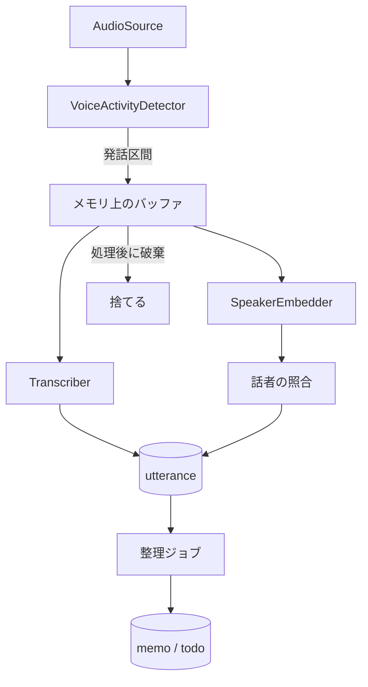

# エンジン設計

`engine/domain` の境界とデータモデルの案。実装しながら更新する。

## ポート

`domain` はこのインターフェース越しに外部を使う。

| ポート | 役割 | 本物の実装 | テスト用 |
|---|---|---|---|
| `AudioSource` | PCM のフレームを流す | `AudioRecord` | WAV ファイル |
| `VoiceActivityDetector` | フレームを発話か無音かに分ける | sherpa-onnx | 区間を指定する Fake |
| `Transcriber` | 発話区間を文字にする | sherpa-onnx | 固定の文字列を返す Fake |
| `SpeakerEmbedder` | 発話区間から特徴量を作る | sherpa-onnx | 固定のベクトルを返す Fake |
| `Llm` | プロンプトから文章を生成する | 検証後に決定 | 固定の応答を返す Fake |
| `TextEmbedder` | 文章の検索用ベクトルを作る | 検証後に決定 | 固定のベクトルを返す Fake |
| `Repository` 群 | DB の読み書き | SQLite | SQLite(テストでも本物) |
| `Clock` | 現在時刻 | システム時刻 | 指定できる時計 |
| `Notifier` | リマインドの通知 | Android の通知 | 呼び出しを記録する Fake |

## 処理の流れ

- 発話区間は上限の長さで区切り、長い発話でもメモリが増え続けないようにする
- 音声のバッファは、文字起こしと話者の処理が終わったら捨てる。例外のときも必ず捨てる
- 処理が追いつかないときは、古い音声から捨てて、欠落を記録する

## データモデル

| テーブル | 主な項目 | 補足 |
|---|---|---|
| `utterance` | 開始・終了時刻、本文、`speaker_id`、信頼度、処理済みの印 | 文字起こしの最小単位 |
| `speaker` | 表示名、名前の由来(自分 / 手動 / 推定)、`is_self` | 手動の名前を推定で上書きしない |
| `speaker_embedding` | `speaker_id`、ベクトル、モデルの版 | モデルが変わると作り直す |
| `memo` | 開始・終了時刻、タイトル、要約、モデルの版 | 発話のまとまり |
| `memo_utterance` | `memo_id`、`utterance_id` | メモの根拠をたどる |
| `todo` | 内容、期限、状態、`memo_id` | 抽出元のメモをたどる |
| `reminder` | `todo_id`、通知時刻、状態 | 通知の予約と実績 |
| `capture_gap` | 開始・終了時刻、理由 | 記録できなかった時間 |
| `memo_embedding` | `memo_id`、ベクトル、モデルの版 | 質問応答の検索用 |

全文検索には SQLite の FTS を使う案を第一候補にする。

## 整理ジョブ

- 未処理の `utterance` を、無音の長さと話題の変化でまとまりに分ける
- 分割は、まず無音の長さの規則で行う。LLM は後から足す
- 再実行しても重複しないように、処理の区切りごとにトランザクションで記録する
- 充電が終わったら、区切りのよいところで止めて次回へ続ける

## リマインド

- 確定した時刻は `AlarmManager`、「充電中に整理」は `WorkManager` に任せる
- 端末の再起動で失われる予約は、起動時に DB から作り直す
- LLM が抽出した期限は誤ることがあるので、確度が低いものは ToDo の候補として表示する
