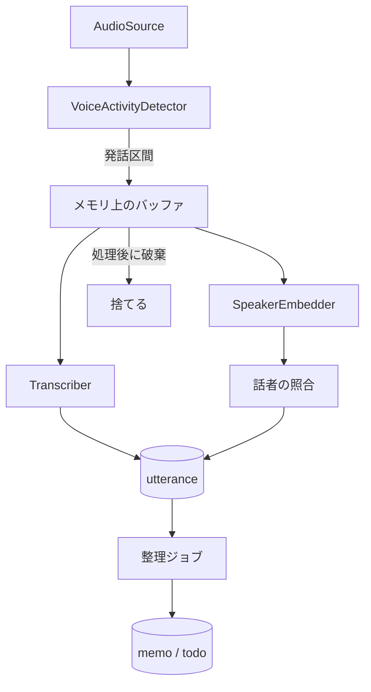

# エンジン設計

`engine/domain` の境界とデータモデルの案。実装しながら更新する。

## ポート

`domain` はこのインターフェース越しに外部を使う。

| ポート | 役割 | 本物の実装 | テスト用 |
|---|---|---|---|
| `AudioSource` | PCM のフレームを流す | `AudioRecord` | WAV ファイル |
| `VoiceActivityDetector` | フレームを発話か無音かに分ける | sherpa-onnx | 区間を指定する Fake |
| `Transcriber` | 発話区間を文字にする | sherpa-onnx | 固定の文字列を返す Fake |
| `SpeakerEmbedder` | 発話区間から特徴量を作る | sherpa-onnx | 固定のベクトルを返す Fake |
| `Llm` | プロンプトから文章を生成する | 検証後に決定 | 固定の応答を返す Fake |
| `TextEmbedder` | 文章の検索用ベクトルを作る | 検証後に決定 | 固定のベクトルを返す Fake |
| `Repository` 群 | DB の読み書き | SQLite | メモリ上の Fake。結合テストは本物の SQLite |
| `Clock` | 現在時刻 | システム時刻 | 指定できる時計 |
| `Notifier` | リマインドの通知 | Android の通知 | 呼び出しを記録する Fake |

実装済みのポートは `AudioSource`、`VoiceActivityDetector`、`Transcriber`、`SpeakerEmbedder`、`Clock`、`UtteranceRepository`、`CaptureGapRepository`。定義は `engine/domain` の `Ports.kt` にある。

Fake、`WavAudioSource`、契約テストは `domain` の `testFixtures` に置き、`adapters` のテストからも使う。本物のアダプターを足すときは、`testFixtures` の契約テストの抽象クラスを継承して流す。

## 処理の流れ

- 発話区間は上限の長さで区切り、長い発話でもメモリが増え続けないようにする
- 音声のバッファは、文字起こしと話者の処理が終わったら捨てる。例外のときも必ず捨てる
- 処理が追いつかないときは、古い音声から捨てて、欠落を記録する

## 最初のゴールのパイプライン

`CapturePipeline` が発話の検知から保存までを担当する。読み取りと文字起こしを別のコルーチンに分け、文字起こしが遅れても読み取りを止めない。

| 部品 | 役割 |
|---|---|
| `UtteranceSegmenter` | 語頭のリングバッファと、発話の上限ぶんの作業用バッファだけを持ち、発話区間を切り出す |
| `SegmentBacklog` | 文字起こし待ちの発話の置き場所。音声の長さの合計に上限を持つ |
| `SpeechSegment` | 発話の音声。`close` で 0 に塗りつぶす |

### 発話の区切り

既定値は仮。`CaptureConfig` で変えられる。

| 項目 | 既定値 | 内容 |
|---|---|---|
| `maxUtteranceMillis` | 30 秒 | 超えると分割する。分割した区間の時刻は連続する |
| `minSilenceMillis` | 0.7 秒 | この長さの無音で発話の終わりとする |
| `preRollMillis` | 0.3 秒 | 検知より前の音声を残して、語頭の欠けを防ぐ |
| `minSpeechMillis` | 0.2 秒 | 短い音は雑音として捨てる。欠落にはしない |
| `maxBacklogMillis` | 120 秒 | 文字起こし待ちの音声の上限。16 kHz で約 3.8 MB |
| `discontinuityToleranceMillis` | 0.2 秒 | フレームの時刻のずれの許容量 |

### 失敗と欠落

音声を残さないので、失敗した発話はやり直せない。捨てた時間は `capture_gap` に残す。

| 起きたこと | 動き | `capture_gap` の理由 |
|---|---|---|
| 待ちが上限を超えた | 古い発話から捨てて続ける | `PROCESSING_BACKLOG` |
| 文字起こしか保存に失敗した | その発話を捨てて続ける | `PROCESSING_FAILED` |
| フレームの時刻が進む方向に飛んだ | 発話を区切り、VAD をリセットして続ける | `SOURCE_DISCONTINUITY` |
| フレームの時刻が戻った | 発話を区切り、VAD をリセットして続ける | 記録しない |
| 読み取りか VAD に失敗した | 溜まった発話を処理してから例外を投げる | 記録しない |
| キャンセルされた | 処理中、待ち、開いている発話を捨てる | `PIPELINE_STOPPED` |
| 欠落を保存できない | 例外で止まる。バッファは解放する | 記録できない |

- 欠落の書き込みは文字起こしのコルーチンで行う。文字起こしの最中に起きた欠落は、その発話が終わってから保存する
- キャンセルかどうかは例外の型ではなく、コルーチンの状態で判断する。アダプターの内側の `withTimeout` で処理全体が止まらないようにするため
- プロセスの強制終了では、メモリ上の音声も欠落の記録も失われる
- 読み取りの失敗から再開までの時間と、プロセスが止まっていた時間は、まだ記録しない

### 話者

`SpeakerEmbedder` はポートと Fake だけを用意し、`CapturePipeline` からは呼ばない。特徴量の保存先がまだなく、呼んでも電池を使うだけなので、話者識別を足すときに `process` の `use` の内側に足す。

## Android 側の実装

`engine/android` がポートの本物をつなぎ、`modules/engine-bridge` が JS へ公開する。

| 部品 | 役割 |
|---|---|
| `Engine` | プロセスに1つ。依存の組み立て、開始と停止、発話の読み出し |
| `CaptureRunner` | `CapturePipeline` を1本だけ動かし、状態を公開する。最初のフレームが届いて初めて聞き取り中にする |
| `CaptureService` | マイク型の Foreground Service。`Engine` の状態を見て、止まったら自分で終わる |
| `PcmReaderAudioSource` | `AudioRecord` の読み取りをフレームにする。JVM のテストで契約テストを流す |
| `BootReceiver` | 再起動後に通知を出すだけ。マイクは開始しない |

- 発話の検知と文字起こしの実装を決める場所は、ビルド種別ごとの `speechComponents()` だけ。Debug は `src/debug` の開発用の Fake で、Release は `null` を返して開始を拒む。Fake のコードは Release に入らない
- 開発用の VAD は音声を見ず、時間で周期的に発話と判定する。音声の入らないエミュレーターでも流れを確かめるため。画面と通知に「開発用」と出す
- フレームの時刻はサンプル数から数える。壁時計との差が `AudioRecord` のバッファ(1 秒)を超えたら音声が失われたとみなし、時刻を飛ばして `SOURCE_DISCONTINUITY` にする。それより短い欠落は検知できない
- 読み取りに失敗すると Service は止まり、画面と通知で知らせる。自動で再開はしない。バックグラウンドからマイクを開始できないため、`START_NOT_STICKY` にしている
- 話者識別がまだないので、JS へ渡す発話の話者はすべて `other` にしている

## データモデル

| テーブル | 主な項目 | 補足 |
|---|---|---|
| `utterance` | 開始・終了時刻、本文、`speaker_id`、信頼度、処理済みの印 | 文字起こしの最小単位 |
| `speaker` | 表示名、名前の由来(自分 / 手動 / 推定)、`is_self` | 手動の名前を推定で上書きしない |
| `speaker_embedding` | `speaker_id`、ベクトル、モデルの版 | モデルが変わると作り直す |
| `memo` | 開始・終了時刻、タイトル、要約、モデルの版 | 発話のまとまり |
| `memo_utterance` | `memo_id`、`utterance_id` | メモの根拠をたどる |
| `todo` | 内容、期限、状態、`memo_id` | 抽出元のメモをたどる |
| `reminder` | `todo_id`、通知時刻、状態 | 通知の予約と実績 |
| `capture_gap` | 開始・終了時刻、理由 | 記録できなかった時間 |
| `memo_embedding` | `memo_id`、ベクトル、モデルの版 | 質問応答の検索用 |

全文検索には SQLite の FTS を使う案を第一候補にする。

スキーマの版 1 にあるのは `utterance` と `capture_gap` だけ。`utterance` の `speaker_id` と処理済みの印は、使うときに ALTER TABLE で足す。本文の列名は `body`。時刻は UNIX エポックからのミリ秒で持つ。`java.time` は minSdk 24 の端末で使えないので、`domain` に持ち込まない。

## SQLite のライブラリ

SQLDelight を使う。

| 候補 | 判断 |
|---|---|
| SQLDelight | 採用。同じ生成コードに Android と JVM のドライバーを差し替えられ、JVM の結合テストで本物の SQLite を動かせる。SQL をビルド時に検査し、マイグレーションの検証タスクもある。AGP 9 の Android ライブラリで動くことを確かめた |
| Room | 不採用。`domain` の Repository の裏に置くには注釈処理の準備が重い。JVM のテストの構成も SQLDelight より手間がかかる |
| 手書きの SQL | 不採用。Android の `SQLiteDatabase` と JDBC で別々のコードになり、テストと本番の実装が分かれる |

- JVM のテストは `sqlite-driver`(xerial の sqlite-jdbc)、端末は `android-driver` を使う
- 端末と JVM で SQLite の版が違う。SQLDelight の既定の方言(3.18)で検査し、新しい構文を使わない。Android 固有の動きは実機で確かめる
- `SqlDriver` を使う Repository の実装は `engine/adapters` に置く。`adapters` は Android ライブラリのままで、テストは JVM の単体テストとして動く

## スキーマの変更

1. `engine/adapters/src/main/sqldelight/migrations/<今の版>.sqm` に移行の SQL を書き、`.sq` も同じように変える
2. `engine/gradlew -p engine :adapters:generateDebugAmbientMemoDatabaseSchema` で新しい版の `databases/<新しい版>.db` を作り、コミットする
3. `engine/adapters/src/test/resources/migration-seeds/<新しい版>.sql` に、その版の全テーブルを埋める行を書く。過去の版の `.db` と種データは変更しない

`mise run test` は次のことを確かめる。

- `verifySqlDelightMigration`: 過去の版に `.sqm` を当てた結果が `.sq` と一致する
- `SchemaMigrationTest`: すべての版のスナップショットに種データを入れて現在の版へ移行し、構造が新規の DB と同じで、行と列の値が残っている

## 整理ジョブ

- 未処理の `utterance` を、無音の長さと話題の変化でまとまりに分ける
- 分割は、まず無音の長さの規則で行う。LLM は後から足す
- 再実行しても重複しないように、処理の区切りごとにトランザクションで記録する
- 充電が終わったら、区切りのよいところで止めて次回へ続ける

## リマインド

- 確定した時刻は `AlarmManager`、「充電中に整理」は `WorkManager` に任せる
- 端末の再起動で失われる予約は、起動時に DB から作り直す
- LLM が抽出した期限は誤ることがあるので、確度が低いものは ToDo の候補として表示する
